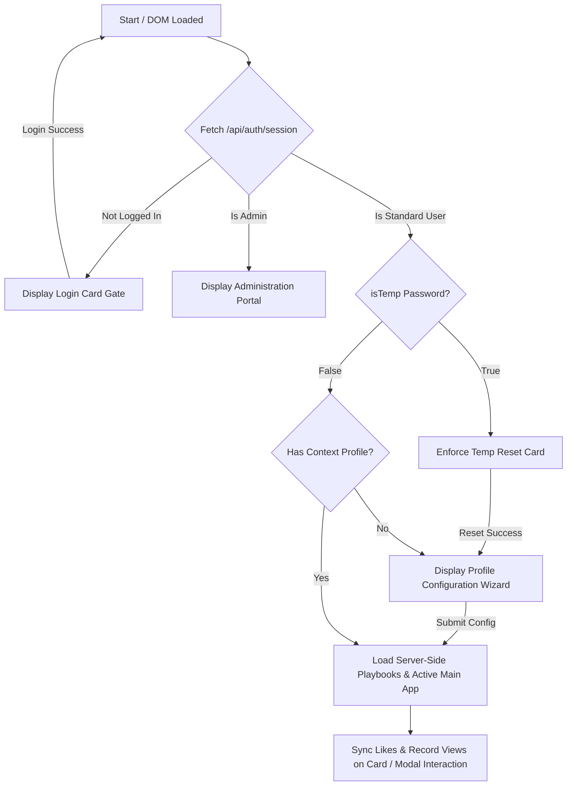

# Gemini Enterprise - Edu Portal Developer Guidelines (`AGENT.md`)

This document serves as the persistent single source of truth for the **Google Gemini Enterprise Education Adoption & Playbook Portal**. It outlines the technology stack, specific coding and terminology preferences, design guidelines, and the current implementation state.

---

## 1. Technology Stack & Architecture

The application is built as a high-fidelity, dynamic web application supported by a secure containerized Node.js backend.

* **Backend Server:** Node.js + Express framework (`server.js`) powering dynamic REST APIs, session storage, and database management.
* **Dual Database Layer:**
  * **Production (PostgreSQL):** Production-ready pool configuration (`pg`) optimized for container scaling on Google Cloud Run.
  * **Local/Offline Fallback (SQLite):** File-based SQLite (`edu_portal.db`) with automatic table structures creation.
* **VM Sandbox Seeding Module:** Securely parses and extracts 14 static scholastic/operational playbooks and translations from `app.js` on first boot inside an isolated Node `vm` context, eliminating seed duplication. Includes a 6-month historical log generator to populate visual analytics out-of-the-box.
* **Authentication Gateways:** Enforced via `express-session` cookies and `bcryptjs` hashing.
  * **Master Admin Account:** `edu_portal_s_admin` with password `***REMOVED***`.
  * **Admin Assist Account:** `edu_portal_admin` with password `***REMOVED***` (cannot Create, Update, or Delete use case playbooks).
  * **Demo Admin Account:** `demo-admin` with password `***REMOVED***` (inherits identical assistant admin rights and permissions as `edu_portal_admin`).
  * **Standard Accounts:** Email-based provisioning with auto-generated 10-character temp passwords. Force-reset of credentials is strictly enforced on first login. Each user has an optional `ge_app_link` (their Gemini Enterprise app URL) used by **Try it**.
  * **Invited DB Admins:** `admins` table (role `super` | `assist`). Super admins invite by email → verification link (`/?verify=TOKEN`, 48h) → set password. Verified DB admins can use **Forgot password** (`/?reset=TOKEN`, 1h). Tokens stored as sha256 in `auth_tokens`, single-use. Hard-coded accounts remain as break-glass logins.
* **Email (`lib/mailer.js`, nodemailer):** SMTP config lives in the DB (`app_settings.smtp`), edited in **Admin → Settings → Email** (super only). Password encrypted with AES-256-GCM (`lib/secrets.js`, key `SETTINGS_ENCRYPTION_KEY` → `SESSION_SECRET`). Resolution: DB config → `SMTP_*` env → demo mode (links logged / shown to super admin only).
* **Infographics (`lib/infographics.js`, `scripts/generate-infographics.js`):** Vertex `gemini-nano-banana-2.1` (locations/global, 16:9 image) → uploaded via GCS JSON API to public bucket `your-infographic-bucket` → URL in `use_cases.infographic_url`. CLI: `npm run infographics [-- --force] [-- --id=<id>]`. GCP token/headers in `lib/gcp.js`.
* **Prompt Types:** `use_cases.prompt_type` and helper prompt `type` ∈ general | notebooklm | deep_research | agent_designer | canvas | image | video. General/Canvas/Image/Video show **Copy prompt + Try it** (`ge_app_link?q=<prompt>`); NotebookLM/Deep Research/Agent Designer show **Copy prompt** only.
* **Seeding:** `seedDatabase()` upserts the 14 playbooks (never wipes `infographic_url` / admin-edited `prompt_type`).
* **Markup & Client Logic:** Vanilla HTML5 paired with modular ES6+ client-side logic (`app.js`). Hydrates page templates dynamically from `/api/use-cases` on session validation.
* **Styles & Visual Identity:** Pure Swiss Minimalism Vanilla CSS (`style.css`), powered by CSS variable maps. **TailwindCSS is strictly avoided** to preserve precise typographic scale and structural grids.

---

## 2. Terminology & Brand Boundaries

Strict guidelines govern how features, products, and connectors are named. These boundaries must be strictly observed in all UI elements and translations:

### Approved Terminology
* **Enterprise Title:** `Gemini Enterprise - Edu Portal` (Avoid *"Antigravity"* or general references).
* **Main Models & Features:** `NotebookLM` (Never refer to it as *"NotebookLM Enterprise"*), `Gemini`, `Canvas Mode`, `Deep Research`, `Agent Designer`, `Image Generation` (Never use *"Nano Image Gen"*), `Video Generation`.

### Forbidden Terminology
* **Never** use the term **"Gem"** (always use **"Agent"**).
* **Never** use the term **"Copilot"**.

### Localization Boundary
* Keep product and system names (*NotebookLM*, *Gemini*, *Canvas Mode*, *Deep Research*, *Agent Designer*, *Image Generation*, *Video Generation*) strictly in **English** within both Traditional Chinese (`zh-TW`) and Simplified Chinese (`zh-CN`) translations.

---

## 3. Design Aesthetics & Legibility Rules

The portal is designed with a premium, state-of-the-art aesthetic that shifts dynamically between light and dark modes:

* **Dark/Light Mode Theme Variable Management:**
  * Backgrounds, borders, and main cards are driven by CSS variables (e.g., `--bg-primary`, `--border-glass`).
  * Ggradient title elements (like `.welcome-msg`) use dynamic color variables (`var(--welcome-msg-start)` and `var(--welcome-msg-end)`) to prevent low-contrast text failures in light mode. In light mode, headings shift gracefully to elegant dark slate/steel colors rather than retaining light/white gradients.
* **Icon Softening:**
  * Utility icons inside side panels and secondary items use soft muted colors (`var(--text-muted)`) rather than stark black/white colors, ensuring a quiet, premium aesthetic that lights up elegantly on active hover states.
* **No Placeholders:**
  * Standard icons are rendered using the Google Material Symbols Outlined font library.
  * Overlapping UI buttons (such as the **Copy Prompt** button in the sandbox drawer) are properly padded to ensure clear separation and zero element overlapping.

---

## 4. Connector & Dynamic Variable Logic

The portal supports intelligent integration simulation and dynamic prompt customization:

* **Nomenclature:**
  * All connector components are named generically in user-facing toasts and badges to ensure product agnosticism (e.g., **Drive Connector**, **Email Connector**, **Calendar Connector**, **LMS Connector**) rather than referencing vendor-specific software.
  * Every connector icon/chip uses the single `.tag-connector` class (red: `--connector-ink` #F28B82 dark / #D93025 light, soft red tint + red border). GE feature chips stay neutral. Do not reintroduce per-connector colours.
* **Essential Connectors vs. Optional Connectors:**
  * Use cases that strictly require an active integration carry a `connectorEssential: true` tag and show a locked overlay when their corresponding connector is toggled off.
  * Use cases where integrations are secondary enhancements are tagged with `connectorEssential: false` and remain unlocked at all times.
* **Manual Workflow Tips Box (Replaced Dual-Mode Toggle):**
  * Rather than complex dual-prompt switches, playbook detail views feature a streamlined, clean prompt container accompanied by a non-intrusive manual tips box (`.manual-tip-box`) recommending the manual file upload fallback workflow if institutional connectors are inactive or unavailable.
* **Dynamic "Fill in the Variables" Engine:**
  * Prompts automatically scan for variable tokens (e.g. `[COURSE_NAME]`, `[ASSIGNMENT_TOPIC]`).
  * The variables panel (`#wbVariables`, one input per row) is the only content of the modal hero's right column; the left column (`.uc-hero-main`) is the infographic with the summary below it. With no variables the hero is a single full-width column (`.uc-hero-row.is-single`).
  * Editing variable values dynamically interpolates into both the highlighted prompt preview and the instant clipboard copy action.
* **Collapsible Prompt (Default Closed):**
  * Step instructions display prompts inside a `
` container, collapsed by default to maintain a clean, compact view per modern prompt library standards.

---

## 5. Current Implementation State

The following dynamic authorization, session gating, and admin workflows are 100% verified, compiled, and operational:

* **Instant Translation Chain:** Language switches translate the full portal, sidebar filters, active user context metrics, and interactive toasts in real-time.
* **Product-Agnostic Notifications:** Simulating connectors issues clean native toasts, fully localized across English (`en`), Traditional Chinese (`zh-TW`), and Simplified Chinese (`zh-CN`).
* **Likes & Views:** Cards and the modal show a heart (like, optimistic with rollback + explicit toasts on 401 session expired / 403 admin preview) and a read-only eye view counter. Every modal open records a `view` event and bumps the counter optimistically. Deploy was removed everywhere (endpoint, UI, filter, analytics).
* **SVG Vector Graph Charts:** The admin statistics view aggregates database events and paints high-contrast line charts showing Views, Likes, and Try it launches over the last 6 months.

---
## 6. Cloud Run Production & Dev Deployments

* **Production Environment:**
  * **Service Name:** `your-service`
  * **GCP Project:** `your-gcp-project-id`
  * **Active Region:** `your-region` (Hong Kong)
  * **Production Endpoint URL:** [https://your-service-PROJECT_NUMBER.your-region.run.app](https://your-service-PROJECT_NUMBER.your-region.run.app)
  * **Custom Domain:** [https://portal.example.com](https://portal.example.com)

* **Dev Environment:**
  * **Service Name:** `your-dev-service`
  * **GCP Project:** `your-gcp-project-id`
  * **Active Region:** `your-region` (Hong Kong)
  * **Database:** `your_dev_db` on Cloud SQL instance `your-sql-instance`
  * **Dev Endpoint URL:** [https://your-dev-service-PROJECT_NUMBER.your-region.run.app](https://your-dev-service-PROJECT_NUMBER.your-region.run.app)

---

############# 7. App State & Progress
 
##### Accomplished Tasks (Latest Session Milestone — 2026-10-19, Set up prompts in DB + Drive Connector + Scholarship v2, commit `a3cd129` on `main`; dev rev `your-dev-service-00014-4ml`, prod rev `your-service-00038-d9w`; Playwright `test_workflows.js` 34/34, `test_canvas_helpers.js` 15/15, `test_admin_helpers.js` 11/11 on local, dev and prod)
* **Set up prompts stored in the DB:** new column `use_cases.helper_prompts` (JSON `{ en|zh-TW|zh-CN: [{type,title,prompt}] }`; NULL = static `useCaseHelperPrompts` in `app.js`, `{}` = none). Seeds write it from `app.js` on boot; GET `/api/use-cases` + export return `helperPrompts`; POST inserts, PUT uses `COALESCE`. Pure validator `lib/helper-prompts.js` (max 5 per language, type whitelist, 400 on bad input). The client syncs `useCaseHelperPrompts` from the API, so the use-case modal shows DB helpers.
* **Admin case form:** new "Set up prompts" fieldset (`#formCaseHelpers`, max 5 rows, type select + title/prompt per language, new rows default to `canvas`; blank zh fields fall back to EN; removing all rows stores `{}`). Pure helpers `helpersToRows` / `rowsToHelpers` in `app.js`. Read-only for assistant admins.
* **Gemini drafting:** `DRAFT_CONVENTIONS` rule 9 (SET UP PROMPTS, localised Canvas sentence); the original sent to Gemini includes stored `helperPrompts`; the schema returns `helperPrompts` (echo stored or draft 1–3). `lib/draft-normalize.js` adds `normalizePromptType`, `normalizeHelperPrompts` and `ensureCanvasSentence` (swaps an English Canvas sentence on zh prompts for the zh one). Diff viewer shows one Set up prompts row per language. Live local draft returned 1 canvas helper per language.
* **Special Consideration:** `connectors: ["Drive Connector"]` with a 4-step connector guide (en / zh-TW / zh-CN); STEP 1 · TRIGGER names the Drive Connector watching `{{INTAKE_FOLDER}}`. (Overrides the earlier no-connector rule for this case only.)
* **Scholarship Application Coach Workflow Agent v2 (en / zh-TW / zh-CN):** forward-only for Agent Designer. Manual trigger start form (typed / pasted text only) → profile sheet → eligibility check → condition routing (5A not eligible / 5B questions for the office → run ends; 5C story plan / 5D draft scorecard → continue) → MENTOR REVIEW (approval node: Approve or Reject, reviewer `{{MENTOR_EMAIL}}`) → 7A next steps / 7B returned by mentor. Knowledge Sources on agent nodes; no loops, pauses or uploads; `connectors: []`. Variables: INSTITUTION_NAME, SCHOLARSHIP_NAME, DEADLINE, WORD_LIMIT, MENTOR_EMAIL.
* README: schema row, admin console bullets and the generate-gemini row updated.
* **Open:** seeded playbooks (including their Set up prompts) are re-synced from `app.js` on every boot, so admin edits to seeded ids reset on deploy. Edit `app.js` for permanent seed changes, or add a "don't overwrite if edited" flag (`updated_at` vs seed) later. Prod's 7 admin-created playbooks have no Set up prompts yet; add them in the case form or with Draft with Gemini.

##### Previous Milestone (2026-10-18, Special Consideration v3 + Gemini 3.8 drafting, commit `b09e525` on `main`; dev rev `your-dev-service-00013-mxm`, prod rev `your-service-00037-2tz`; Playwright `test_workflows.js` 32/32 and `test_canvas_helpers.js` 15/15 on local, dev and prod)
* **Special Consideration Workflow Agent v3 (en / zh-TW / zh-CN):** fewer manual steps. STEP 1 · TRIGGER fires when a student's application form lands in `{{INTAKE_FOLDER}}`, then: read application → evidence & policy check → condition routing (5A evidence request / 5B standard decision / 5C escalation) → HUMAN REVIEW (Approve or Reject) → 7A letter + log / 7B returned log. Forward-only, Knowledge Sources on agent nodes, `connectors: []` kept. Variables: OFFICE_NAME, INSTITUTION_NAME, INTAKE_FOLDER, AUTO_LIMIT_DAYS, WELFARE_EMAIL.
* **New third helper (canvas):** "Prompt to Generate a Sample Student Application Form" (fictional data, sections A–G, two variants: missing evidence and welfare concern).
* **Admin "Draft / Refine with Gemini":** now uses `GEMINI_MODEL` (default `gemini-3.8-flash`; UI labels say 3.8 Flash). `server.js` has `DRAFT_CONVENTIONS` + pure `buildDraftPrompt` (`{{UPPER_SNAKE}}` variables with identical keys across languages, 3-step pattern, Canvas sentence for documents, promptType rules, Agent Designer limits, connector names, brand rules). Replies pass through new pure `lib/draft-normalize.js` (`[VAR]` → `{{VAR}}`, snake_case id, category / promptType / feature / connector whitelists).
* **Client:** request sends `promptType`; drafts set the Prompt type select; diff viewer shows a Prompt type row. Category fix: form option `admin` → `administrative`, `normalizeCaseCategory` on load / apply, filter accepts legacy `admin`, boot runs an idempotent `UPDATE use_cases SET category='administrative' WHERE category='admin'`.
* Live local check: a drafted "Lab Safety Induction Quiz" returned `promptType: canvas`, 4 `{{VARIABLE}}` tokens in en and zh-TW, no `[VAR]` brackets.
* **Open (resolved 2026-10-19):** Drive Connector added, Set up prompts moved to the DB with an admin editor, Scholarship rebuilt forward-only.

##### Previous Milestone (2026-10-18, Special Consideration workflow fits Agent Designer limits, commit `189f725` on `main`; dev rev `your-dev-service-00012-wcl`, prod rev `your-service-00036-pw7`; Playwright `test_workflows.js` 32/32 on local and both)
* **Why:** Agent Designer rejected the old flow for three reasons. Forms and steps cannot take file uploads, the approval node has only Approve / Reject (no Edit), and cycles (the "restart from Step 2" loop) are not allowed.
* **New flow (en / zh-TW / zh-CN):**
  1. KNOWLEDGE SOURCES: policy, evidence rules table and letter templates, attached in the UI to the agent nodes.
  2. MANUAL TRIGGER form: typed request details, plus an optional Google Drive evidence link that only the reviewer opens. The Agent never opens links, so there is still no connector.
  3. Evidence and policy check (agent node).
  4. Condition node routes to 4A evidence request, 4B standard decision or 4C escalation brief. All three continue forward.
  5. HUMAN REVIEW approval node, Approve or Reject.
  6. Approve → 6A final letter + log row. Reject → 6B log row "Rejected, returned to staff" with no letter.
* **Missing evidence:** handled by starting a new run with the same request ID, never by looping back.
* Steps, summary and pro tip were rewritten to match. The helper prompts and infographic were unchanged.
* **Open:** `scholarship_application_workflow` has the same Agent Designer conflicts:
  * a self-score loop back to Step 4
  * PAUSE / wait steps
  * a scholarship call that the student uploads
  * a "help them revise" step after mentor review
  
  Restructure it the same way if it gets validated in Agent Designer.

##### Previous Milestone — 2026-10-18, Canvas keyword on Step 1 "Set up" helpers, commit `95d7240` on `main`; dev rev `your-dev-service-00011-2p5`, prod rev `your-service-00035-hmk`; Playwright 15/15 on local and both
* **26 document-creating helper prompts × 3 languages (78 edits)** in `useCaseHelperPrompts` now end with a Canvas instruction: EN "Use Canvas to create this as an editable document.", zh-TW 「請使用 Canvas 將此內容建立為可編輯文件。」, zh-CN 「请使用 Canvas 将此内容创建为可编辑文档。」. They also switched from `type: "general"` to `type: "canvas"`, so the chip reads Canvas Mode and Try it stays.
* **Covered:** socratic_tutor #0 #1, rubric_grading #0 #1, curriculum_design #1, lab_manual_creator, su_advocacy, club_funding, su_helpdesk, visual_campaign #0, at_risk_cohort, accreditation_reports, workforce_federation, finance_compliance, security_simulator and special_consideration_workflow (#0 #1 each).
* **Skipped on purpose (not documents):**
  * curriculum_design #0 (Deep Research)
  * visual_campaign #1 (art prompts)
  * sao_scavenger_hunt (riddles / quiz)
  * scholarship_application_workflow (summary table from pasted text; interactive Q&A)
* **Rule for new helpers:** if a Set up prompt produces a document, append the Canvas sentence above and set `type: "canvas"`. Helpers are client-only in `app.js`, so no DB or seed change is needed.

##### Previous Milestone — 2026-10-18, Agent Designer workflow playbooks, commit `c2371e9` on `main`; dev rev `your-dev-service-00010-bls`, prod rev `your-service-00034-6pr`; Playwright 30/30 on both
* **2 new seeded playbooks (16 total), both `prompt_type = agent_designer` (Copy only), `connectors: []` by design:**
  * `special_consideration_workflow` (admin staff: role `SAO`, category `administrative`, feature Agent Designer). Six steps: intake → evidence check (IF missing → "Awaiting evidence" email and STOP) → policy routing (escalate on > `{{AUTO_LIMIT_DAYS}}` days, final-exam overlap, welfare flag, or 3rd+ request) → STANDARD letter or ESCALATE brief → **human review always** (Approve / Edit / Reject) → close (final letter + log row for staff to send and paste themselves).
  * `scholarship_application_workflow` (student: role `Student`, category `student`, features Agent Designer + Canvas Mode). Seven steps: profile → eligibility (IF a requirement is not met → STOP and suggest alternatives; IF unclear → PAUSE) → story plan → draft → self-score (IF any criterion < 4 → revise, at most 3 loops) → **required mentor review** (the student sends the pack themselves) → final checklist.
* **No connectors:** files are uploaded into the Agent or pasted into the chat, and a person sends anything that leaves the Agent. No Drive or Email Connector wording appears in any language.
* **Content:** the English text lives once in `SPECIAL_CONSIDERATION_EN` / `SCHOLARSHIP_COACH_EN` at the top of `app.js`, used by both `useCasesDb` and `useCasesTranslations.en`. zh-TW and zh-CN are written in full. Each playbook has 2 trilingual helper prompts.
* **Server:**
  * `SEED_PROMPT_TYPES`, `SEED_QUEST` (timing + 2 hints each) and `SEED_INFOGRAPHIC_VERSIONS` include both ids.
  * `upsertSeedUseCase` now writes `timing` **on insert only**, because the one-time `seed_timing_v1` pass had already run on dev and prod.
* **Infographics:** `CONCEPT_HINTS` added in `lib/infographics.js`; images generated and uploaded to the public bucket ("Sort, Then Sign Off", "Draft, Score, Refine").
* **Verified:** `node --check` passes, and a Playwright modal check passed 30/30 (en + zh-TW: agent_designer copy-only, no connector chips / tips / guide, branches + human review in the prompt, 3 steps, 2 helpers, variables, infographic, no page errors).

##### Previous Milestone — 2026-10-13, v6 Quest Run + colour tones + News (branch `dev/quest-run`, since merged and deployed)
* **Colour tones (100%):** `toneClass(feature)` adds `tone-*` to card feature chips, modal chips and `typeChipHtml`; `#filterFeature[data-tone]` takes the selected feature's tone. NotebookLM / Deep Research green, Canvas / Video blue, Agent Designer yellow, Image purple. Dark and light variants live in the V6 layer at the end of `style.css`. Connectors stay red.
* **Quest Run strip (100%):** `lib/quest-core.js` is a UMD module shared by the server and `window.QuestCore`:
  * calendar defaults and validation, `getAcademicPosition` (term / week / phase)
  * `HERO_CLASS_BY_ROLE` (Wizard / Warrior / Priest), `pickWeightedHint`, `newsStatus`
  * The canvas renderer (`createQuestRenderer` at the end of `app.js`):
    * Draws real sprites from `GET /game/manifest.json`, falling back per asset.
    * Runs at 30 fps and pauses when off-screen or when the tab is hidden. Reduced motion draws a static frame.
    * Adds a dusk tint in the dark theme. Archie swoops in with news.
    * `window.__questDebug` exposes the renderer state for tests.
  * Timeline: 4 terms, month ticks and a today flag. Example label: "Semester A · Week 7 · Midterms".
  * Bubble: rotates every 30 s, with pause and collapse; the collapsed state persists.
  * News: bell badge and drawer; dismissals are kept in localStorage.
  * `mountQuestRun()` is called from all 4 portal entry paths.
* **Backend (100%):**
  * New tables `quest_hints` (22 seeded) and `announcements`; new column `use_cases.timing`; `app_settings.academic_calendar`.
  * New endpoints: `/api/quest`, `/api/quest/event` (logged to analytics as `hint:<id>` / `news:<id>`), `/api/admin/hints`, `/api/admin/announcements` (adds seen/click counts and returns per-field 400 errors), `/api/admin/settings/calendar` (super), `/api/admin/translate`.
  * The Gemini drafting schema also returns timing and hints.
* **Admin UI (100%):**
  * **News** tab for all admins:
    * form: trilingual fields with counters, link or playbook, audience chips, dates, pin
    * live scroll preview, field validation, Translate with Gemini
    * table with status, reach and clicks
  * **Settings → Calendar** (super admins only): adjacent terms update together when a date changes, a live "Today" preview, Save, and Reset with a confirmation.
  * Case form: 7 timing chips (Anytime excludes the others) and up to 3 trilingual quest questions.
  * All new strings are in `uiTranslationsV6` (en / zh-TW / zh-CN).
* **Verified:**
  * `node --check` passes for all changed files.
  * Playwright `test_v6.js` passes 37/37 (desktop and mobile, light and dark, zh-TW, reduced motion, news publish → scroll → drawer → dismiss, calendar save/reset driving `/api/quest`, case form chips) with no console errors.
  * The `test_v6_base.js` regression suite also ran. Screenshots are `v6_*`.

##### Previous Milestone — 2026-10-12, v5 modal + cleanup
* **Modal v5 (100%):** hero = left column (infographic + summary directly below) / right column = only the variables panel (`.is-single` full width when no variables). Like + view counter moved into the modal header (`#modalPref` in `.modal-header-actions`, left of ×, 44px, own delegated click). Under 720px the header is a grid: tags + controls on row one, full-width title on row two (no overflow at 390px).
* **Connector chips (100%):** modal header tag row shows connector chips after the GE feature chips; all connector icons/chips use one red `.tag-connector` scheme; `.connector-tag-drive/email/lms/calendar` removed.
* **Use-case "Verified" removed (100%):** card/modal badge, admin table column (now 7 cols), `formCaseVerified` checkbox + payload, keys `verifiedLabel`, `adminCrudThVerified`, `caseFormVerified(Desc)`, `yes`/`no`, `.tag-verified` CSS. Saved `ge_active_status` other than `liked` → `all`. Server no longer reads/writes/returns `isVerified`; `use_cases.is_verified` kept and documented as deprecated. Admin invite email verification untouched.
* **Feedback UI blue (100%):** floating button `#1A73E8` (hover `#1557B0`), white text, blue focus ring; modal icon `var(--accent)`; submit `.btn-feedback-submit` blue; textarea focus blue. No purple left.
* **Bug fix:** SQLite `updated_at` migration used a non-constant default and silently failed on older DBs, so every admin use-case PUT errored (`no such column: updated_at`); now added bare + backfilled.
* **Verified:** `node --check`, Playwright `test_v3.js` (adapted + new checks: summary under image, variables alone on the right, header like/view/close, no Verified anywhere, red connector chips on cards + modal, blue feedback, admin create/edit without isVerified) — see results below; screenshots `v5_*`.

##### Previous Milestone — 2026-10-12, v4 modal polish
* **Modal v4 (100%):** "Fill in the variables" moved from the full-width panel into the hero right column (compact `.uc-vars` section, one input per row, hidden when no variables; hero top-aligned, stacks image → summary → variables under 900px). Steps get 24px inner padding (16px mobile), 56px summary rows with 20px padding, roomier prompt body/actions. **Try it** = green `#1e8e3e` (hover `#137333`), **Copy prompt** = blue `#1a73e8` (hover `#1557b0`), white text/icon, same in both themes, coloured focus rings, equal heights; `promptActionButtonsHtml` lost its `primary` option. Dead CSS removed (`.prompt-variables-panel/header/title/subtitle/grid`, old `.uc-vars` grid rules).
* **README rewrite (100%):** architecture table + mermaid flowchart, exact schema (9 tables incl. `sessions`) + erDiagram, API overview, env var table, Cloud Run + Secret Manager deploy, Terraform. No passwords/secrets in README.
* **Verified:** `node --check`, Playwright `test_v3.js` (adapted: hero variables column, one-column inputs, green/blue buttons, step padding ≥16px) all passing, no console errors; screenshots `v4_*`.

##### Previous Milestone — 2026-10-12, v3 UI
* **Likes root cause fixed (100%):** express-session used the default MemoryStore, so Cloud Run scale-to-zero / new instances dropped every session; like POSTs then returned 401 and the client swallowed it silently. Sessions now persist in the DB (`lib/session-store.js`, `sessions` table, lazy prune); `requireStandardUser` returns `session_expired` (401) / `admin_preview` (403); the client rolls back and toasts. Verified a session survives a server restart.
* **Views replace Deploy (100%):** `/api/use-cases/deploy` removed; GET `/api/use-cases` returns `likeCount` (+ legacy `totalLikes`) and `viewCount`; POST `/view` returns the new `viewCount`; admin stats use `totalViews` and history views/likes/tries.
* **Modal (100%):** Copy prompt removed from the hero; "Fill in the variables" panel moved into the overview (open, responsive auto-fill grid) between the summary row and How it works; values interpolate into main + helper prompts; Step 2 = collapsed sample prompt with Copy / Try it by type; chips and the Try it nudge focus the overview panel.
* **UI polish (100%):** dark card/panel borders `--line-card` rgba(255,255,255,.16) with .30 hover; feedback modal icon/title centred; floating Feedback only in the user portal (hidden on auth cards + admin); Admins panel above Add users.
* **Particle field rewrite (100%):** organic teardrop droplets with per-particle sine drift, springs for length/scale, lerped angle/alpha, idle Lissajous focus, ≤1200 particles, DPR ≤2, paused when hidden, static frame under reduced motion, touch support.
* **Verified:** `node --check`, curl (401/403/like/unlike/view/404 deploy, session across restart), Playwright `test_v3.js` 109/109 (desktop + mobile, light + dark, admin), no console errors.
* **Infographics (100%):** 14 Nano Banana infographics generated, public in `gs://your-infographic-bucket`, shown as the hero of the enlarged card; admin Generate / Regenerate / Generate missing.
* **Admin Auth & Email (100%):** Admin invites (super/assist) with email verification, forgot/reset password, SMTP settings UI with presets (Gmail, Outlook.com, Microsoft 365, Custom), encrypted password, test send, demo-mode fallback.
* **Users (100%):** `ge_app_link` column (demo-user@example.com set), Edit user modal (email rename cascades prefs/analytics/feedback, GE app link, reset access).
* **Prompt Types & Try it (100%):** per-prompt type chip; Try it deep-links to `ge_app_link?q=`; copy-only for NotebookLM/Deep Research/Agent Designer; `try` analytics event + Tries stat.
* **Unified Responsive UI (100%):** shared 72px topbar for user + admin, admin tab row (Users · Analytics · Use cases · Feedback · Settings), sidebar removed, dropdown filter bar (Category / GE feature / Collection / Sort), headline "{n} playbooks for {role}", unclipped auto-height cards (3/2/1 cols), 13px type floor, fewer words, humanized variable labels (no `{{ }}`), workbench details side-by-side & collapsed, full-screen modal sheet on mobile.
* **Particle Field (100%):** `initParticleField()` canvas of colored dashes reacting to mouse/touch (replaces `initMouseGlow`), reduced-motion aware.
* **Verified locally:** curl API suite, local SMTP catcher delivery, Playwright 57/57 (desktop + mobile, light + dark).
* **Cleanup (100%):** remaining hard-coded English strings (login, temp reset, case form, Gemini drafting, diff viewer, feedback modal, toasts/confirms) moved into `uiTranslationsV3` (en / zh-TW / zh-CN, 372 keys each) with `data-i18n*` attributes (`data-i18n-title` added); dead functions removed (`setupConnectorToggles`, `checkMissingConnector`, `handleOnboardingSubmit`, `getCategoryByRole`, etc.); 66 legacy sidebar/hub/lock/switch CSS rules pruned; top-level `sessionStorage` read guarded so the vm seeder works; README rewritten (invites, password recovery, SMTP, Try it, infographics, env vars, new schema). Verified: Playwright 57/57 + zh-TW i18n check, no console errors.

### Next Steps & Continuous Polish
00. **v6.2 Quest Run deployed to PROD (2026-10-13, revision `your-service-00030-586`; `dev/quest-run` merged into `main`):**
    * v6.2: Archie's news is shown as a parchment scroll. It has rolled ends, Caveat handwriting (Kaiti fallback for CJK), a red "📜 News from Archie" ribbon and an unroll clip-path animation (`.is-unrolling`), and respects reduced motion.
    * v6.3 pixel scroll: the CSS-gradient scroll was replaced with Nano Banana pixel art from the game pipeline (`npm run game-assets -- --only=scroll,wax_seal`, new `sprite` kind).
      * `game/scroll.png` (160x64) is applied as a 9-slice `border-image` (slice 14/16), with corners and rolls at an integer `--px` scale (2 desktop, 1 mobile).
      * `game/wax_seal.png` (24x30) sits bottom-right on desktop and top-right on mobile.
      * The kicker uses the pixel blackletter font "Jacquarda Bastarda 9"; the message stays in Caveat handwriting. The unroll animation is stepped.
      * The admin News preview width was fixed.
    * v6.4 pixel font: all news text (kicker, headline, body, action button) uses 方舟像素字体 / Ark Pixel 12px proportional (OFL, `fonts/ark-pixel/OFL.txt`, self-hosted, `COPY fonts` in the Dockerfile). The Google Fonts link for Caveat/Jacquarda was removed.
      * Faces: "Ark Pixel Latin" is an 11KB woff subset made with `pyftsubset` from the release OTF (Brotli isn't installed locally, so the output is woff, not woff2). "Ark Pixel TC"/"Ark Pixel SC" are the full release woff2 files (~550KB), loaded lazily. `--font-news` switches TC/SC by `html[lang]`, with a system CJK fallback for rare hanzi (e.g. 獻).
      * Sizes stay on the 12px grid (kicker/body 12px, headline 24px desktop / 12px mobile), with no faux bold and no smoothing.
    * Favicon: transparent pixel Archie (sprite frame 3) with a 1px parchment outline so it reads on dark tabs. `apple-touch-icon` keeps a parchment tile because iOS blackens transparency.
      * Generate with `npm run favicons` (`scripts/generate-favicons.js`, sharp, PNG-in-ICO packing).
      * Links use `?v=archie2` to bust caches.
      * Deployed to both prod and dev.
    * v6.1 polish: tone chips are solid Google fills (green #1E8E3E research, blue #1A73E8 create, yellow #FBBC04 agent with dark ink, red #D93025 connectors; white ink); card/panel borders much stronger (`--line-card` dark .34 / light .32); quest bubble right-aligned with a fixed width, hero at 7% (mobile 10%), Archie confined to the lane left of the bubble (`laneRight()` measures the bubble) with random retargets every 4–8s.
    * Playwright `test_v6.js` 37/37 on dev, plus the `test_v6_base.js` regression suite. Sprites ship in the image (`game/`). Mobile card column overflow fixed (`minmax(0,1fr)`).
    * The 7 prod-only admin-created use cases default to timing `anytime` with no quest hints. Add hints in the case form and run **Generate missing** infographics.
    * Don't commit `node_modules/sharp` / `node_modules/@img` (macOS binaries for the asset script; `sharp` is a devDependency only).
    * Set the real academic calendar in Settings → Calendar.
    * Review and expand the 22 seeded quest questions per role.
    * Translate with Gemini needs Vertex AI credentials (it returns 502 without them).
    * Optionally build an admin UI for standalone `quest_hints`; today the questions are edited per playbook in the case form, and the server allows 5 per playbook while the client allows 3.
0. **v5 deployed to prod (2026-10-12, revision `your-service-00029-z2s`):** modal v5, red connectors, Verified removal, blue feedback, SQLite `updated_at` fix; Playwright `test_v3.js` 157/157 on prod. Dev (`your-dev-service`) is still behind; redeploy it if needed.
1. **Dev deployed (2026-10-12, revision `your-dev-service-00004-h68`):** `SETTINGS_ENCRYPTION_KEY` + `INFOGRAPHIC_BUCKET` set, timeout 600s; DB-backed sessions (likes fixed); views replace deploys; **Archimedes infographics v2** (raven-graduate mascot, cel-shaded editorial vector, reference `imgs/archimedes-ref.jpg` sent to Nano Banana, per-case `CONCEPT_HINTS`) auto-upgraded via `applySeedInfographics()` (only replaces older `?v=` of the same object); Playwright 109/109 on dev.
   **Prod deployed (2026-10-12, revision `your-service-00028-zh5`)** with v4 modal polish (variables in hero column, green Try it / blue Copy prompt, step padding), own `SETTINGS_ENCRYPTION_KEY`, timeout 600s; Playwright 124/124 on prod. Prod has 7 extra admin-created use cases without infographics → run **Generate missing** in Admin → Use cases. Dev is one revision behind (redeploy dev to match).
2. **Terraform:** `terraform import` the bucket + IAM created via gcloud before the next `apply`.
3. **Configure real SMTP** in Admin → Settings → Email (Gmail App Password or Outlook) and run an end-to-end invite + forgot password.
4. **Optional CSS cleanup:** still-unused legacy selectors remain in `style.css` (roadmap / timeline / pipeline / milestone / mobile-timeline / flag-* / prompt-variables-*); remove after a visual check.
5. **Monitor User Feedback** from the floating widget in the admin portal.

##### Previous Milestones
* **Typographic Balance & Hierarchy (`/frontend-design`) (100% Complete):**
  * Established unified Swiss typography stack: `Outfit` (display/headings), `Plus Jakarta Sans` (interface body text), and `JetBrains Mono` (prompts, syntax, variable tokens).
  * Formulated full modular type scale (`--text-3xs` through `--text-4xl`), letter tracking (`--tracking-tighter` through `--tracking-widest`), and humanist line-height tokens (`--leading-none` through `--leading-relaxed`).
* **Enlarged Expanded Card View (Modal) (100% Complete):**
  * Expanded modal bounds to `94vw`, `max-width: 1360px`, `88vh` height with a 2-column prompt workbench layout (`350px 1fr`, responsive `1fr` on mobile).
  * Generous padding on use case titles (`8px 0 10px 0`), modal headers, and top navigation bar (`height: 72px; padding: 0 40px;`).
* **Interactive `{{}}` Variable Tokens & Click-to-Focus (100% Complete):**
  * Modernized variable tokens to `{{VARIABLE_NAME}}` format (supporting legacy `[...]` backwards compatibility).
  * Rendered clickable colored tokens (`.prompt-var-token`, `.token-braces`, `.is-filled`) in the prompt display that smoothly scroll, focus, and pulse (`@keyframes pulseVariableFocus`) the matching variable input field in the left column.
  * Real-time bi-directional interpolation between input fields, highlighted prompt display, and clipboard copy buffer.
* **Mouse-Reactive Ambient Background (100% Complete):**
  * Hardware-accelerated radial spotlight tracking cursor movement (`--mouse-x`, `--mouse-y`) over the subtle architectural canvas grid via `requestAnimationFrame`.
* **Enhanced Card Contrast & Rounded Surfaces (100% Complete):**
  * High-contrast card surfaces against dark ink canvas, defined `1.5px` borders, and rounded corners (`18px` on cards, `24px` on dialog modals).
* **Connector Filter Simplification (100% Complete):**
  * Removed connector toggle switches and lock overlays; replaced with clean colored indicator tags (`.connector-tag-drive`, `.connector-tag-email`, `.connector-tag-lms`, `.connector-tag-calendar`). All cards remain permanently unlocked.
* **3 Conceptual Steps Architecture (100% Complete):**
  * Refactored all 14 playbooks into 3 clear conceptual steps:
    1. **Step 1: Setup & Grounding** (with embedded collapsible helper prompts).
    2. **Step 2: Execute Sample Prompt** (with embedded 2-column interactive prompt workbench).
    3. **Step 3: Human Review & Delivery** (with manual upload fallback tip box and pro-tip container).
* **Prerequisite Helper Prompts Embedded in Steps (100% Complete):**
  * Added collapsible helper prompt cards with 1-click clipboard copying under Step 1 for prerequisites (e.g., generating assignment instructions and analytical grading rubrics for *Rubric-Aligned Essay Feedback Assistant*).
  * Fully populated and localized for all 14 use cases across English (`en`), Traditional Chinese (`zh-TW`), and Simplified Chinese (`zh-CN`).
* **Dev Cloud Run Deployment Ready (100% Complete):**
  * Validated server startup, schema migration, and API response locally with SQLite.

