# Gemini Enterprise - Edu Portal

[](#-run-and-deploy)
[](docs/REFERENCE.md#-architecture)
[](#-what-makes-a-good-playbook)

A playbook library that helps schools and universities **actually use Gemini Enterprise**. Lecturers, researchers, staff and students find ready-made playbooks for their own work, fill in a few details and open them in Gemini Enterprise. When something is missing, they suggest it, and an admin turns the idea into a new playbook with Gemini in a few minutes.

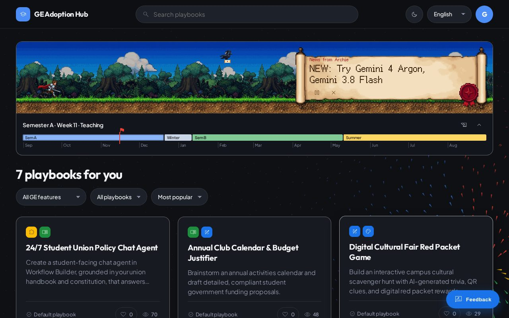

---

## 📖 Contents
1. [The idea in one picture](#-the-idea-in-one-picture)
2. [For users: find, try, suggest, compete](#-for-users-find-try-suggest-compete)
3. [For admins: from idea to playbook](#-for-admins-from-idea-to-playbook)
4. [What's in the library](#-whats-in-the-library)
5. [What makes a good playbook](#-what-makes-a-good-playbook)
6. [Run and deploy](#-run-and-deploy)
7. [Estimated monthly cost](#-estimated-monthly-cost)

Technical details (data model, API, environment variables, Terraform) are in [docs/REFERENCE.md](docs/REFERENCE.md). Self-hosting and the full cost breakdown are in [docs/HANDBOOK.md](docs/HANDBOOK.md).

---

## 💡 The idea in one picture

The portal is a loop. People use playbooks; their ideas become new playbooks; the library grows with the institution's real needs.

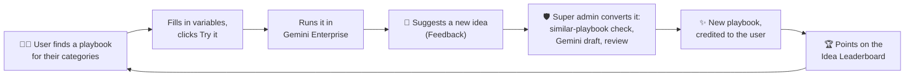

Three ideas run through everything:
* **Right playbooks for the right people.** Each account and each playbook has categories (Teaching, Research, Leadership, Student Affairs, Finance, Security, IT, Students). People only see what matches their work.
* **One click from idea to Gemini.** Variables are filled once; **Try it** opens Gemini Enterprise in the browser the user is already signed in to.
* **Contributing is a game.** Ideas, the playbooks they become, and the likes and views those playbooks get all earn points on a public **Idea Leaderboard**.
* **Humans stay in charge.** Gemini drafts playbooks, but an admin reviews every one, and every playbook keeps a person in the loop before anything reaches students.

---

## 👩‍🎓 For users: find, try, suggest, compete

### 1. First sign-in: a short tour
The first time someone signs in, five tips walk them through the portal: filters, playbook cards, Try it, the Quest Run strip and Feedback. They can replay the tips any time from the account menu (**Show tips**).

| Tip 1: find the right playbook | Tip 3: fill in, then Try it |
| :---: | :---: |
| 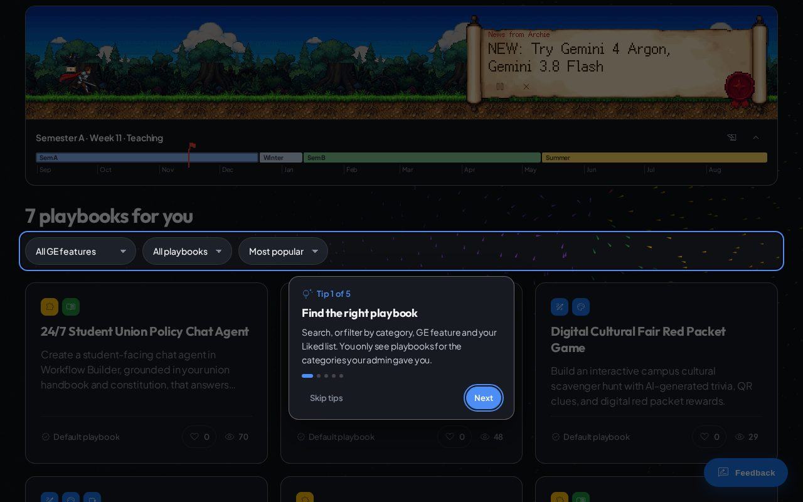 | 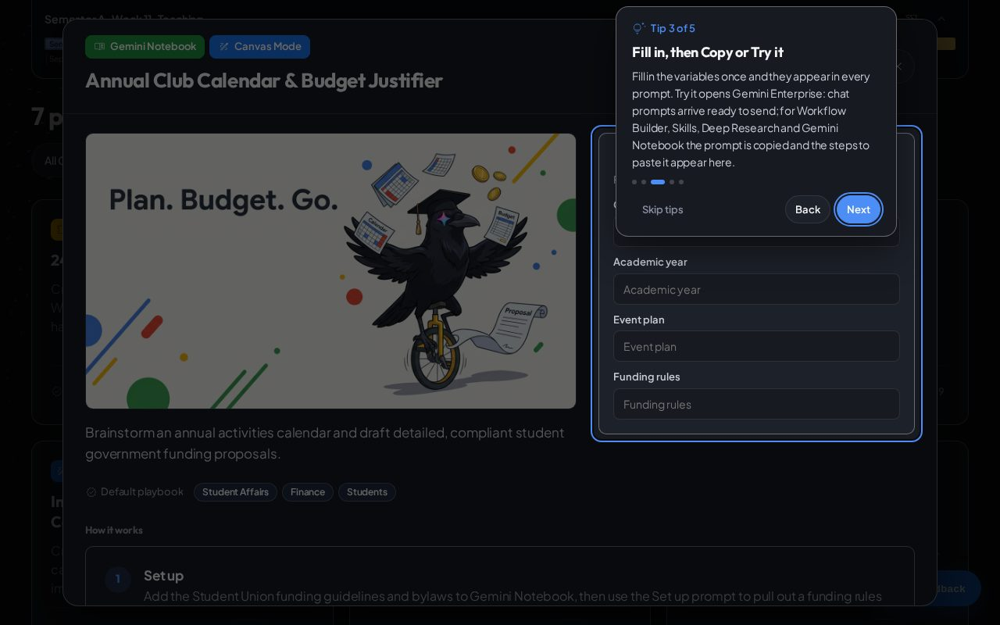 |

### 2. Open a playbook
Every playbook has the same shape: an infographic and summary, the **variables** to fill in once, and three steps (**set up**, **run the prompt**, **review and share**). Set up prompts help people prepare what they need (a rubric, a sample, a template). The **Quest Run** strip on the home page suggests playbooks that fit the current point of the academic year.

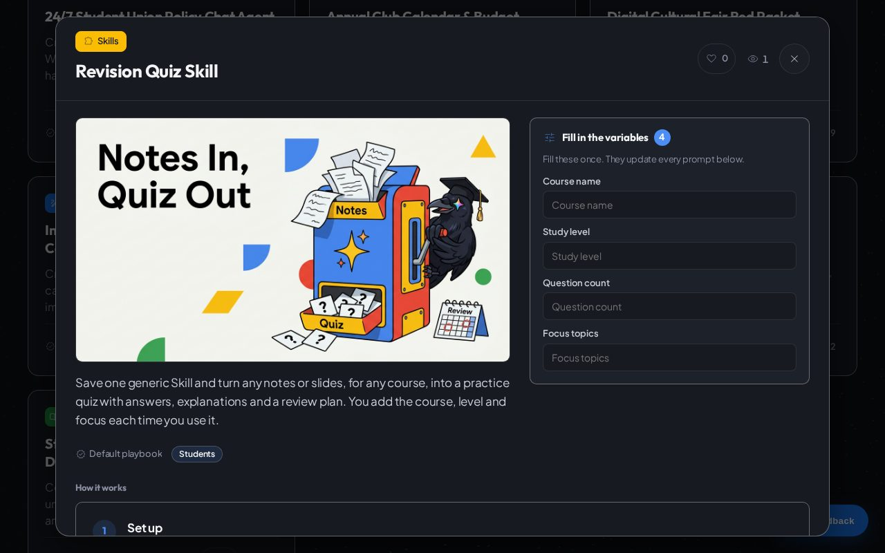

### 3. Try it: straight into Gemini Enterprise
No copying between tabs. The variables the user filled in are already inside the prompt (the green chips), and **Try it** sends that finished prompt to **their own Gemini Enterprise app**, in the browser where they're already signed in.

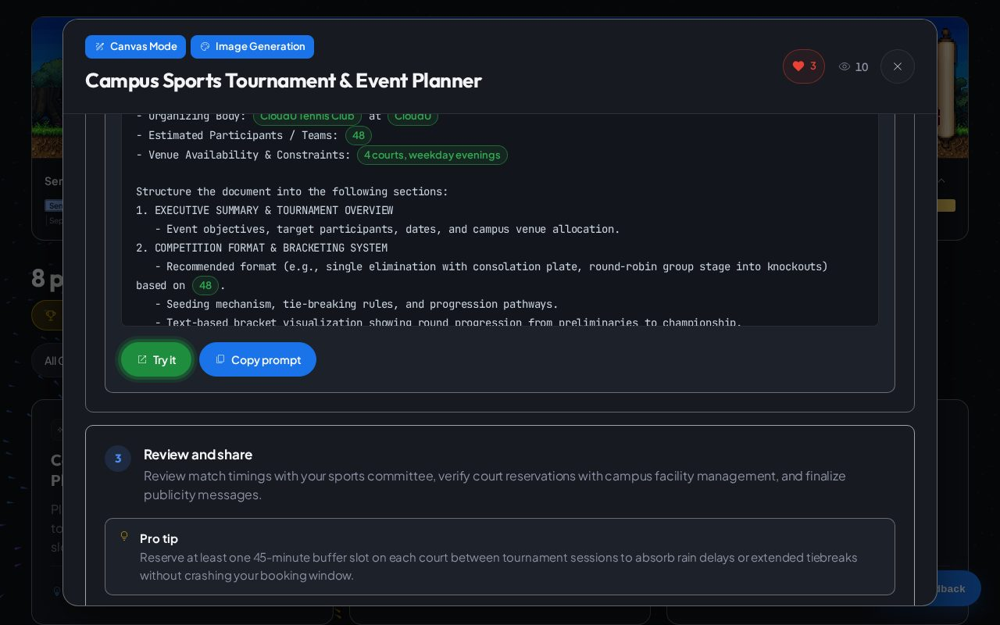

* **Chat, Canvas, Image and Video prompts** open in Gemini Enterprise **with the prompt already in the chat box**: press Enter and it runs. Each user's own app link is set by an admin, so it always opens the right Gemini Enterprise.
* **Workflow Builder, Skills, Deep Research and Gemini Notebook** can't be prefilled from a link (Gemini Enterprise documents no deep links into them). Try it copies the prompt, opens Gemini Enterprise and shows exactly where to paste it, so it's still one paste away.

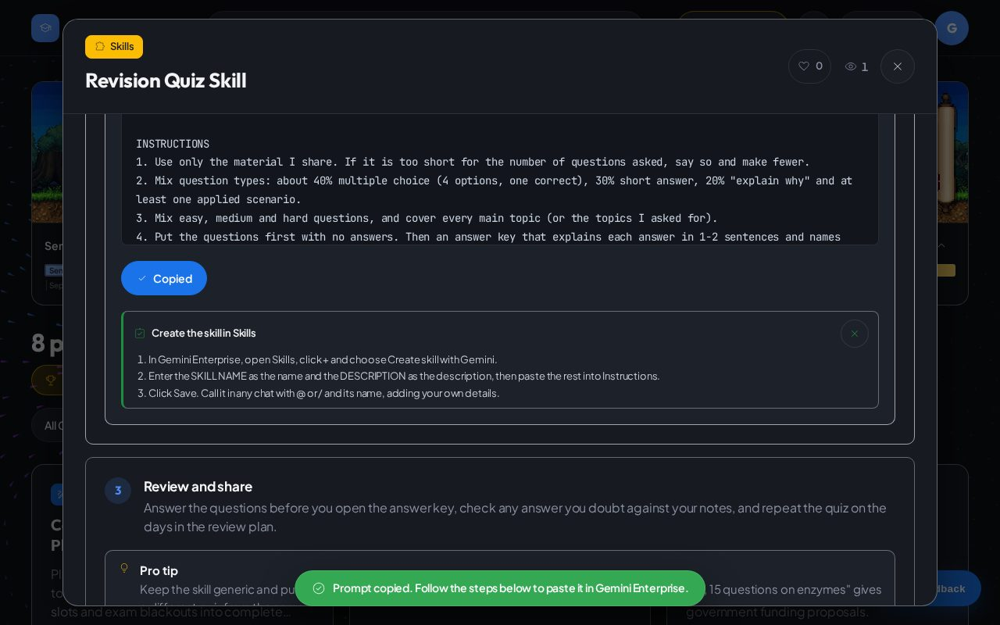

### 4. Suggest an idea
The **Feedback** button takes ideas as well as bugs. A short hint asks for who it's for, the task and what Gemini should produce, and empty or vague notes ("great, thanks!") are gently rejected so admins get ideas they can act on.

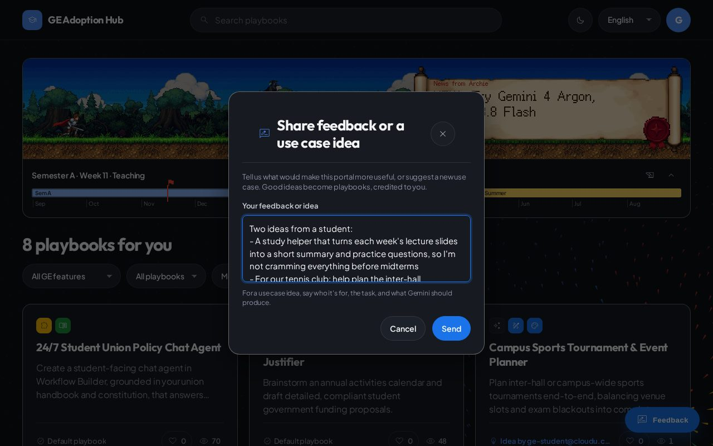

### 5. Climb the Idea Leaderboard
Every contribution counts. Contributors earn points for each idea they submit, more when an idea becomes a playbook credited to them, and more again for every like and view that playbook gets. The **Leaderboard** (the trophy at the top) shows:
* a **podium** for the top three contributors and the rest of the top ten;
* **your standing**: your rank, your points and how many more you need to move up;
* the **most liked** and **most viewed** playbooks, with "Idea by …" credits;
* this month, the last 3 or 6 months, or all time.

A line above the playbook grid keeps it in view ("You're #2 on the Idea Leaderboard with 27 pts"), and **Suggest an idea** is one click away. Users see short names (the part before "@"), never full email addresses.

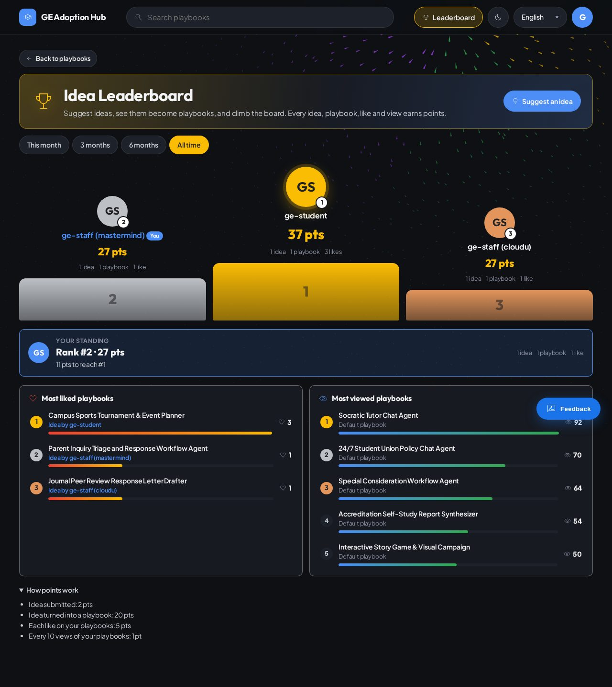

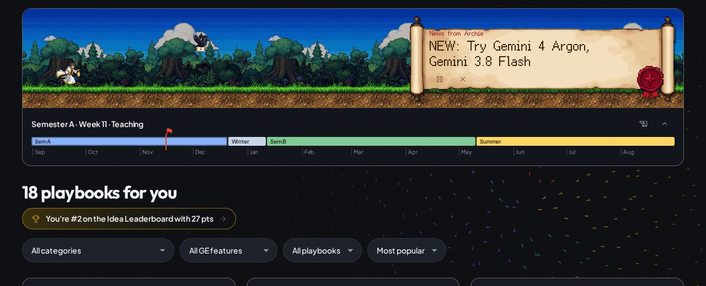

| Action | Points |
| :--- | ---: |
| Submit an idea | 2 |
| Your idea becomes a playbook | 20 |
| Each like on your playbooks | 5 |
| Every 10 views of your playbooks | 1 |

---

## 🛡️ For admins: from idea to playbook

Admins have their own console (Users · Analytics · Use cases · Feedback · News · Settings) and their own five-tip tour on first sign-in.

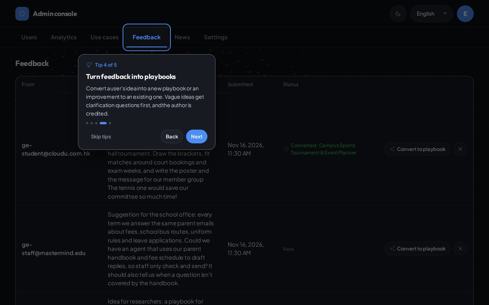

### The conversion workflow

**Step 1: Read the ideas.** New suggestions arrive in **Feedback** with the author and status.

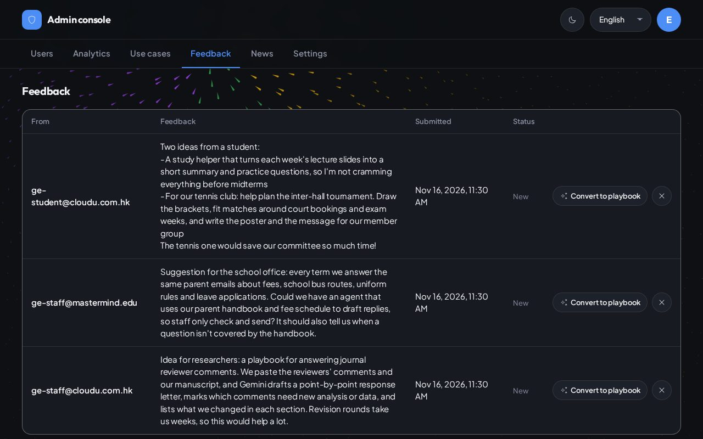

**Step 2: Convert to playbook.** Gemini compares the idea with the existing library and recommends **improving** a close match or **creating a new** playbook. If the idea is too vague, the dialog asks one to three clarification questions first (with an "Ask the author by email" link).

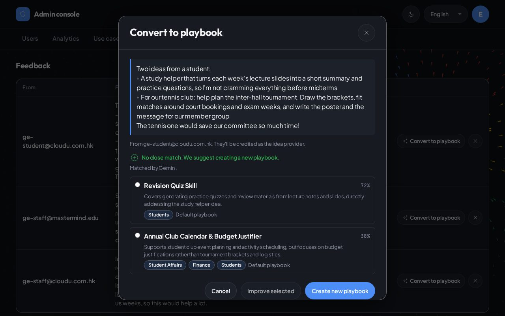

**Step 3: Let Gemini draft it.** The form opens with the idea shown read-only and Gemini drafts the whole playbook: steps, prompt, Set up prompts, categories, Quest timing and the zh-TW / zh-CN translations. Gemini also picks the **features that fit the job** (for example Skills for a repeated task, a workflow agent for an approval process) and explains its choice.

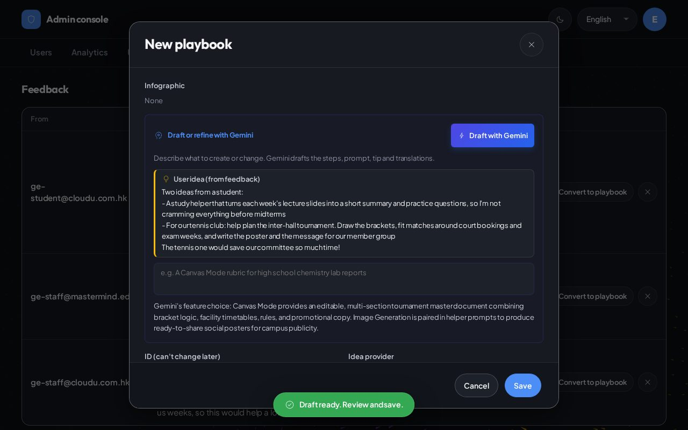

**Step 4: Review and save.** The admin checks and edits the draft, then saves. The feedback is marked **Converted** and links to the new playbook.

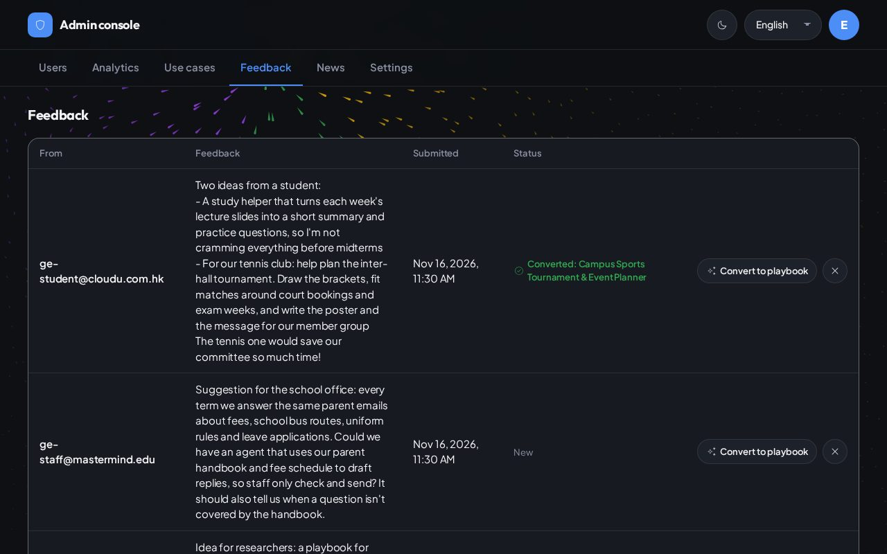

**Step 5: It's live, credited to the author.** The playbook appears for the matching categories with "Idea by …". Generate an infographic with one click.

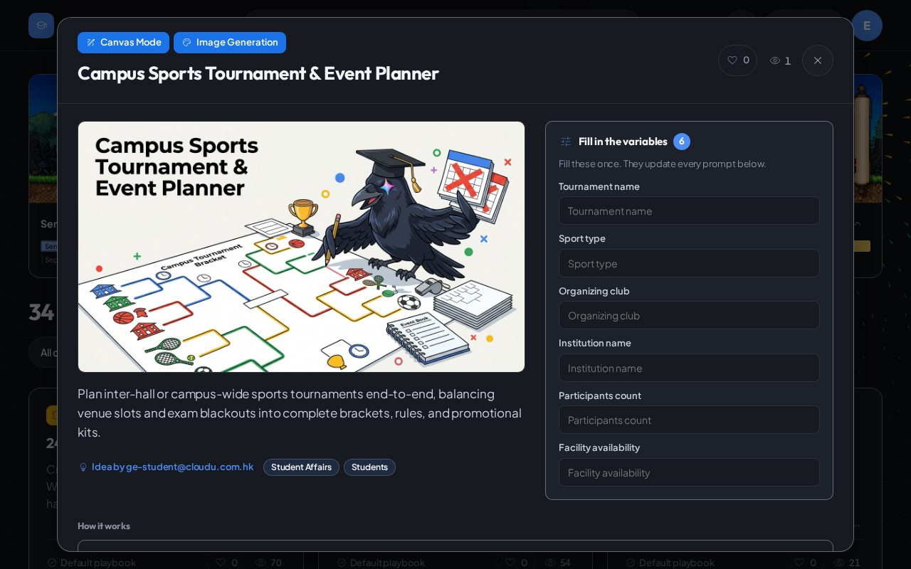

The same Gemini drafting is used when an admin creates a playbook from scratch or improves an existing one, so every path follows the same rules.

### Watch the competition
**Analytics** has the same podium and boards with full email addresses, plus totals for community playbooks, idea providers and converted feedback, so admins can see who drives adoption and recognise them.

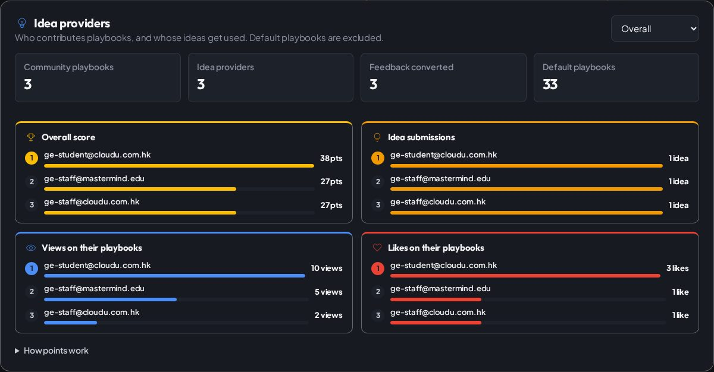

### Tune how Gemini drafts
Super admins can edit the **playbook drafting prompt** in **Settings**: the design steps, the feature guide and the writing conventions Gemini follows. A saved change applies to the next draft; **Reset to default** restores the built-in version.

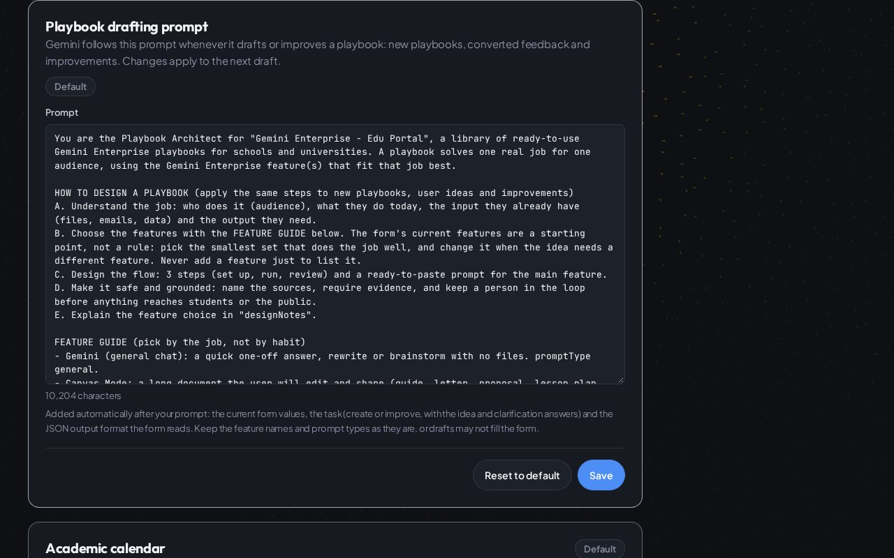

### Everything else in the console
* **Users:** add people by email (temporary password on first sign-in), tick their categories, set each person's Gemini Enterprise link for Try it. Super admins invite other admins (super or assistant).
* **Analytics:** views, likes and Try it launches over time, and the idea-provider podium.
* **Use cases:** create, edit, import / export playbooks; generate infographics.
* **News:** announcements that Archie delivers in the Quest Run strip.
* **Settings:** email (SMTP), the academic calendar and the drafting prompt.

---

## 📚 What's in the library

26 built-in playbooks (plus anything your admins add), in English, Traditional and Simplified Chinese.

| Type | What it is | Examples |
| :--- | :--- | :--- |
| **Workflow Builder · chat agents** | Assistants people talk to over time, grounded in your files | Socratic Tutor, Student Union Policy, IT Service Desk, Campus Safety Drill |
| **Workflow Builder · workflow agents** | Multi-step processes started by a new file (Drive Connector) or email (Email Connector), with conditions and human approval before anything is sent | Special Consideration, Scholarship Screening, Expense Claim Approval, Exam Paper Moderation |
| **Skills** | Generic, reusable procedures saved once and called with `@` in any chat | Revision Quiz, Feedback in my Marking Voice, Lesson Plan, Meeting Minutes |
| **Research** | Evidence and proposals with Deep Research, Gemini Notebook and Canvas Mode | Literature Review Evidence Map, Grant Proposal Builder, Research Ethics Pre-Check |
| **Teaching, students and operations** | Gemini Notebook analysis, Canvas Mode documents, Image and Video Generation | Rubric feedback, curriculum design, club budgets, accreditation reports |

---

## ✅ What makes a good playbook

These rules are built into the drafting prompt, so Gemini's drafts follow them too:

* **Grounded:** prompts that use files list their knowledge sources, cite file and page, and say what to do when the answer isn't there.
* **Human in the loop:** a person reviews before anything reaches students or the public; workflows have explicit approval steps.
* **Fits the real product:** Skills are generic (details come in the request) and can't hold files from the editor; a workflow's knowledge files are added to its steps after Workflow Builder has built the flow.
* **Easy to customise:** `{{VARIABLES}}` only in prompts, plain words in the steps.
* **Consistent language:** product names stay in English in every language; never "Gem" or "Copilot".

---

## 🚀 Run and deploy

**Locally** (SQLite, no cloud needed):

```bash
npm ci
cp .env.example .env    # set SUPER_ADMIN_PASSWORD; everything else is optional
npm start               # http://localhost:8080, sign in as edu_portal_s_admin
```

Gemini drafting and infographics also need `gcloud` credentials for a project with Vertex AI.

**On Google Cloud** (Cloud Run + Cloud SQL + Secret Manager + a public bucket for infographics), from one env file per environment:

```bash
cp .env.example .env.prod                        # project, region, service name, passwords
./scripts/deploy.sh plan --env-file .env.prod    # preview
./scripts/deploy.sh      --env-file .env.prod    # Terraform + build + deploy
./scripts/deploy.sh app  --env-file .env.prod    # later releases: app only
```

Step-by-step self-hosting: [docs/HANDBOOK.md](docs/HANDBOOK.md#2-provision-your-own-instance). All settings, the data model and the API: [docs/REFERENCE.md](docs/REFERENCE.md).

---

## 💰 Estimated monthly cost

List prices checked 2026-10-21 (USD per month, on-demand). Details: [docs/HANDBOOK.md](docs/HANDBOOK.md#3-monthly-cost-estimate-google-cloud).

| Scenario | asia-east2 | us-central1 |
| :--- | ---: | ---: |
| Pilot (~50 users) | ≈ $16 | ≈ $11 |
| Department (~500 users) | ≈ $49 | ≈ $35 |
| Campus-wide (~5,000 users) | ≈ $129 | ≈ $97 |

Cloud SQL is most of the bill; Cloud Run scales to zero. Gemini is pay-per-use and only triggered by admins.

---

*Gemini Enterprise - Edu Portal: from idea to playbook, with people in charge.*
