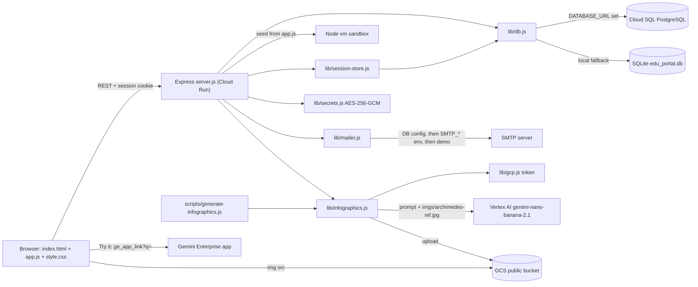
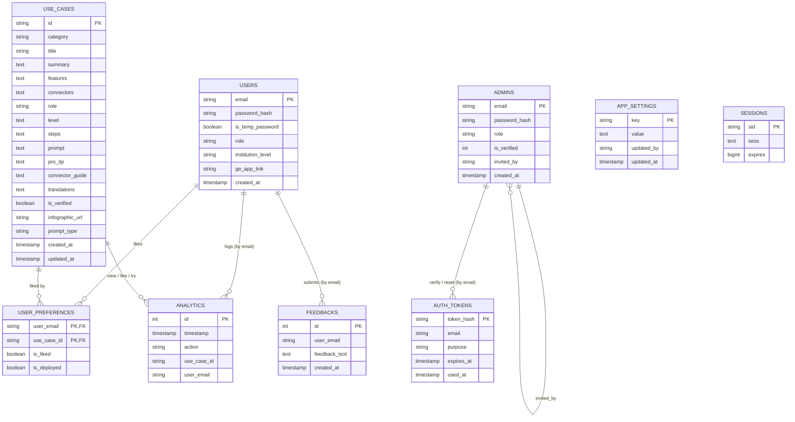

# Gemini Enterprise - Edu Portal

[](#-deployment)
[](#-architecture)
[](#-localization)

The **Gemini Enterprise - Edu Portal** is a playbook library for academic institutions adopting Gemini Enterprise. Leaders, lecturers, support staff and students browse role-specific use cases, fill in a prompt's variables once, then copy the prompt or launch it straight into their Gemini Enterprise app. Admins get user provisioning, analytics, playbook editing, infographic generation and email settings.

---

## 📖 Contents
1. [Features](#-features)
2. [Architecture](#-architecture)
3. [Database schema](#-database-schema)
4. [API overview](#-api-overview)
5. [Local development](#-local-development)
6. [Environment variables](#-environment-variables)
7. [Accounts, roles & password recovery](#-accounts-roles--password-recovery)
8. [Infographics](#-infographics)
9. [Deployment](#-deployment)

---

## 🌟 Features

### Playbook library
* Card grid of playbooks with dropdown filters for **Category**, **GE feature** (Agent Designer, NotebookLM, Deep Research, Canvas Mode, Image Generation, Video Generation), **Collection** (All / Liked) and **Sort** (popular, newest, A–Z). The headline reads "{n} playbooks for {role}".
* Every card shows a **like** button (heart) and a read-only **view** counter (eye).

### Enlarged use-case card (modal)
* **Hero:** the generated infographic on the left. On the right: the summary, the like / view row, and a compact **Fill in the variables** column with one input per row. Values are interpolated live into the main prompt and every helper prompt. Clicking a variable chip in a prompt focuses its field. Playbooks without variables show no variables column. Under 900px the hero stacks: image, summary, variables.
* **How it works:** three steps.
  1. **Set up**: optional helper prompts, each collapsed.
  2. **Sample prompt**: collapsed by default, with its prompt-type chip and actions.
  3. Connector guide, manual-upload tip and pro tip.
* **Actions:** **Try it** (green) opens `<ge_app_link>?q=<prompt>` in a new tab. **Copy prompt** (blue) copies the interpolated prompt. Both look the same in light and dark mode. If a variable is still empty, the first **Try it** click focuses that field and a second click continues anyway.
* Each modal open records a `view` event. The counter goes up optimistically and is then reconciled with the server total.

### Prompt types

| `prompt_type` | Actions |
| :--- | :--- |
| `general`, `canvas`, `image`, `video` | **Try it** + **Copy prompt** |
| `notebooklm`, `deep_research`, `agent_designer` | **Copy prompt** only (these features can't be prefilled from a URL) |

### Admin console
* **Users:** bulk-provision users with temporary passwords. **Edit user** changes a user's email (cascades to preferences, analytics and feedback) and their Gemini Enterprise app link, and can reset access.
* **Admins** (super admin only): invite by email (`super` or `assist`), resend or remove invites.
* **Analytics:** total views, likes and tries; a 6-month line chart; a playbook leaderboard.
* **Use cases:** create, edit, delete, import and export (JSON). Includes Gemini-assisted drafting with a diff viewer, plus infographic **Generate / Regenerate / Generate missing**.
* **Feedback:** review and dismiss submissions from the floating Feedback button. The button only appears in the user portal.
* **Settings → Email** (super admin only): SMTP presets (Gmail, Outlook.com, Microsoft 365, Custom) with a test send.

### Localization
All UI strings live in `uiTranslationsV3` in `app.js` (en / zh-TW / zh-CN) and are applied through `data-i18n`, `data-i18n-placeholder`, `data-i18n-aria` and `data-i18n-title`. Product names (NotebookLM, Gemini, Canvas Mode, Deep Research, Agent Designer, Image Generation, Video Generation) stay in English in every language.

---

## 🏗 Architecture

| Layer | Implementation |
| :--- | :--- |
| Client | `index.html` + `app.js` (vanilla ES6+, functional helpers) + `style.css` (vanilla CSS variables, light/dark; no Tailwind) |
| Server | Node.js 20 + Express (`server.js`): REST API, `express-session` cookies, `bcryptjs` hashing, VM-sandbox seeding of the 14 playbooks from `app.js` |
| Sessions | `lib/session-store.js`: `express-session` store backed by the `sessions` table, with lazy pruning. Sessions survive Cloud Run scale-to-zero and are shared across instances. |
| Database | `lib/db.js`: PostgreSQL (`pg` pool, Cloud SQL) when `DATABASE_URL` is set, otherwise SQLite (`edu_portal.db`). The schema is created and migrated on boot. |
| Secrets | `lib/secrets.js`: AES-256-GCM encryption for secret settings (for example the SMTP password) |
| Email | `lib/mailer.js` (nodemailer). Config comes from the DB (`app_settings.smtp`), then `SMTP_*` env vars, then demo mode. |
| GCP auth | `lib/gcp.js`: access token from the metadata server (Cloud Run) or local `gcloud`, plus the quota-project header |
| Infographics | `lib/infographics.js` + `scripts/generate-infographics.js`: Vertex AI `gemini-nano-banana-2.1` (location `global`, 16:9) with the Archimedes mascot reference image `imgs/archimedes-ref.jpg`. Images go to a public GCS bucket. |
| Hosting | Cloud Run (containerised by the `Dockerfile`) + Cloud SQL for PostgreSQL. Infrastructure lives in `terraform/`. |



---

## 📊 Database schema

These tables are created by `initializeSchemas()` in `server.js` (and `sessions` by `lib/session-store.js`). Columns added later (`is_verified`, `updated_at`, `ge_app_link`, `infographic_url`, `prompt_type`) are added on boot with idempotent `ALTER TABLE` migrations. Types are shown for PostgreSQL; SQLite uses `TEXT` / `INTEGER` / `DATETIME` equivalents.

| Table | Columns |
| :--- | :--- |
| `users` | `email` PK, `password_hash` NOT NULL, `is_temp_password` BOOLEAN default TRUE (forces a reset on first login), `role`, `institution_level`, `created_at`, `ge_app_link` VARCHAR(1024) (Gemini Enterprise app URL for Try it) |
| `use_cases` | `id` PK, `category`, `title`, `summary`, `features` (JSON), `connectors` (JSON), `role`, `level` (JSON), `steps` (JSON), `prompt`, `pro_tip`, `connector_guide`, `translations` (JSON), `is_verified` BOOLEAN, `created_at`, `updated_at`, `infographic_url` VARCHAR(1024), `prompt_type` VARCHAR(50) default `'general'` |
| `user_preferences` | (`user_email` FK→users, `use_case_id` FK→use_cases) composite PK, `is_liked` BOOLEAN, `is_deployed` BOOLEAN (legacy, unused). Both FKs `ON DELETE CASCADE`. |
| `analytics` | `id` SERIAL PK, `timestamp`, `action` (`view` \| `like` \| `try`; old rows may hold `deploy`), `use_case_id`, `user_email` |
| `feedbacks` | `id` SERIAL PK, `user_email` NOT NULL, `feedback_text` NOT NULL, `created_at` |
| `admins` | `email` PK, `password_hash` (NULL until verified), `role` CHECK IN (`super`, `assist`), `is_verified` INTEGER, `invited_by`, `created_at` |
| `auth_tokens` | `token_hash` PK (SHA-256 of the emailed token), `email`, `purpose` (`verify` \| `reset`), `expires_at` (48 h verify / 1 h reset), `used_at` (single use) |
| `app_settings` | `key` PK (for example `smtp`), `value` (JSON; secret fields encrypted), `updated_by`, `updated_at` |
| `sessions` | `sid` PK, `sess` (JSON), `expires` BIGINT (epoch ms) |

The obsolete `verification_checkpoints` table is dropped on boot.



---

## 🔌 API overview

All endpoints return JSON and use the session cookie. "User" means a signed-in standard user (401 `session_expired` / 403 `admin_preview` otherwise). "Super" means a super admin.

| Method & path | Access | Purpose |
| :--- | :--- | :--- |
| `POST /api/auth/login` | Public | Sign in (user email or admin username) |
| `POST /api/auth/reset-password` | User | Replace a temporary password; save role / level |
| `GET /api/auth/session` | Public | Current session, role and profile |
| `POST /api/auth/forgot-password` | Public | Email a reset link (verified DB admins) |
| `POST /api/auth/complete-token` | Public | Finish `?verify=` / `?reset=` and set a password |
| `POST /api/auth/logout` | Any | End the session |
| `GET /api/use-cases` | Signed in | Playbooks with `likeCount`, `viewCount`, the user's like state, `infographicUrl`, `promptType` |
| `POST /api/use-cases/like` | User | Toggle a like |
| `POST /api/use-cases/view` | Signed in | Record a view; returns the new `viewCount` |
| `POST /api/use-cases/try` | Signed in | Log a Try it launch |
| `POST /api/feedbacks` | User | Submit feedback |
| `GET /api/feedbacks` · `POST /api/feedbacks/delete` | Admin · Super | List · dismiss feedback |
| `GET/POST/PUT/DELETE /api/admin/users` · `POST/PUT /api/admin/users/reset` | Admin (writes: Super) | List, provision, edit, delete, reset users |
| `GET/POST/DELETE /api/admin/admins` · `POST /api/admin/admins/resend` | Super | Manage invited admins |
| `GET /api/admin/stats` | Admin | Totals and 6-month history (views / likes / tries) |
| `POST/PUT/DELETE /api/admin/use-cases` · `GET /api/admin/use-cases/export` | Super · Admin | Edit · export playbooks |
| `POST /api/admin/use-cases/:id/infographic` · `POST /api/admin/infographics/generate-missing` | Super | Generate infographics |
| `GET/PUT /api/admin/settings/smtp` · `POST /api/admin/settings/smtp/test` | Super | SMTP settings and test send |
| `POST /api/admin/generate-gemini` | Super | Gemini-assisted playbook drafting |

---

## 🚀 Local development

Prerequisites: Node.js 18+ (the container uses 20) and npm.

```bash
git clone <REPO_URL>
cd edu-ge-adoption-portal
npm install
npm start               # SQLite is used automatically when DATABASE_URL is unset
# open http://localhost:8080 (override with PORT)
```

* Set variables in a local `.env` file (loaded by `dotenv`). Never commit it.
* To use Postgres locally, set `DATABASE_URL` (and `DISABLE_PG_SSL=true` for a local server without TLS).
* Infographic generation locally uses your `gcloud auth application-default` / `gcloud auth print-access-token` credentials, billed to `GCP_QUOTA_PROJECT`.

---

## ⚙️ Environment variables

| Variable | Required | Purpose |
| :--- | :---: | :--- |
| `PORT` | – | HTTP port (default `8080`) |
| `NODE_ENV` | Prod | `production` turns on secure cookies |
| `SESSION_SECRET` | Prod | Signs session cookies. Also the fallback encryption key. |
| `SETTINGS_ENCRYPTION_KEY` | Prod | AES-256-GCM key for secrets in `app_settings`. Use a separate value per environment. |
| `DATABASE_URL` | Prod | PostgreSQL connection string. When unset, SQLite is used. |
| `DISABLE_PG_SSL` | Cloud Run | `true` when connecting over the Cloud SQL Unix socket |
| `SQLITE_PATH` | – | SQLite file path (default `edu_portal.db`) |
| `SUPER_ADMIN_PASSWORD`, `ADMIN_PASSWORD`, `DEMO_ADMIN_PASSWORD` | Prod | Built-in admin passwords. Always set them via environment or Secret Manager. |
| `PUBLIC_BASE_URL` | Recommended | Base URL for emailed links (otherwise the request origin is used) |
| `SMTP_HOST`, `SMTP_PORT`, `SMTP_SECURITY`, `SMTP_USER`, `SMTP_PASS` / `SMTP_PASSWORD`, `SMTP_FROM`, `SMTP_FROM_NAME`, `SMTP_FROM_EMAIL` | – | SMTP fallback when nothing is saved in Admin → Settings → Email |
| `INFOGRAPHIC_BUCKET` | – | Public GCS bucket for infographics |
| `INFOGRAPHIC_MODEL` | – | Default `gemini-nano-banana-2.1` |
| `INFOGRAPHIC_LOCATION` | – | Default `global` |
| `INFOGRAPHIC_PROJECT` | – | Vertex project (defaults to `GCP_PROJECT_ID`) |
| `INFOGRAPHIC_REF_IMAGE` | – | Mascot reference image (default `imgs/archimedes-ref.jpg`) |
| `INFOGRAPHIC_CONCURRENCY` | – | Worker pool for "Generate missing" (1–4, default 2) |
| `GCP_PROJECT_ID` / `GOOGLE_CLOUD_PROJECT` | – | GCP project for Vertex and GCS |
| `GCP_QUOTA_PROJECT`, `GCP_FORCE_QUOTA_HEADER` | – | Quota / billing project header for local credentials |

> [!CAUTION]
> Never put passwords, connection strings with credentials or encryption keys in this README, in `terraform.tfvars` or in Git. Set them through environment variables or Secret Manager. Ask your administrator for the values.

---

## 🔐 Accounts, roles & password recovery

* **Standard users** are provisioned by an admin with an auto-generated temporary password and must change it on first sign-in. They then pick their role and institution level.
* **Built-in admin accounts** (`edu_portal_s_admin` = super, `edu_portal_admin` = assist, `demo-admin` = assist) are break-glass logins. Their passwords are set via environment variables. Ask your administrator.
* **Invited admins** (`admins` table): a super admin invites an email address. The invitee gets a single-use `/?verify=TOKEN` link (48 h) and sets a password. Verified admins can use **Forgot password?**, which sends a `/?reset=TOKEN` link (1 h). Tokens are stored only as SHA-256 hashes.

| Capability | Super | Assist |
| :--- | :---: | :---: |
| View analytics, export playbooks, read feedback | ✅ | ✅ |
| Add / edit / delete / import playbooks, generate infographics | ✅ | ❌ |
| Provision / edit users, reset access | ✅ | ❌ |
| Dismiss feedback | ✅ | ❌ |
| Invite / remove admins, SMTP settings | ✅ | ❌ |

**Email:** configure SMTP in **Admin → Settings → Email**. The SMTP password is encrypted at rest. With no SMTP configured, the portal runs in demo mode: links are written to the server log and shown to the super admin only.

> [!TIP]
> Gmail and Microsoft 365 usually require an app password (or SMTP AUTH enabled for the mailbox) instead of the normal sign-in password.

---

## 🖼️ Infographics

Each playbook can have a 16:9 infographic generated with Vertex AI `gemini-nano-banana-2.1`. The prompt includes per-case concept hints, and the Archimedes mascot reference (`imgs/archimedes-ref.jpg`) is sent as inline image data so the character stays consistent. Images are uploaded via the GCS JSON API to a public bucket, and the URL (with a `?v=` cache-buster) is stored in `use_cases.infographic_url`.

```bash
npm run infographics                 # only playbooks without an infographic
npm run infographics -- --force      # regenerate everything
npm run infographics -- --id=<id>    # a single playbook
```

Admins can also generate from **Admin → Use cases**. The Cloud Run service account needs `roles/aiplatform.user` and object-admin access to the bucket. The bucket grants `allUsers` `roles/storage.objectViewer`.

---

## ☁️ Deployment

Target: **Cloud Run** + **Cloud SQL for PostgreSQL**. The Cloud Run service account needs `roles/cloudsql.client`, plus the infographic roles above.

### Deploy from source

```bash
gcloud run deploy <SERVICE_NAME> \
  --source . \
  --region <REGION> \
  --project <PROJECT_ID> \
  --allow-unauthenticated \
  --timeout 600 \
  --add-cloudsql-instances <PROJECT_ID>:<REGION>:<INSTANCE_NAME> \
  --set-env-vars NODE_ENV=production,DISABLE_PG_SSL=true,INFOGRAPHIC_BUCKET=<BUCKET_NAME>,PUBLIC_BASE_URL=<https://your-domain> \
  --set-secrets DATABASE_URL=<DB_URL_SECRET>:latest,SESSION_SECRET=<SESSION_SECRET_NAME>:latest,SETTINGS_ENCRYPTION_KEY=<ENC_KEY_SECRET>:latest,SUPER_ADMIN_PASSWORD=<SUPER_PW_SECRET>:latest,ADMIN_PASSWORD=<ADMIN_PW_SECRET>:latest,DEMO_ADMIN_PASSWORD=<DEMO_PW_SECRET>:latest
```

* `DATABASE_URL` uses the Cloud SQL Unix socket form `postgres://<DB_USER>:<DB_PASSWORD>@/<DB_NAME>?host=/cloudsql/<INSTANCE_CONNECTION_NAME>`. Keep it in Secret Manager, never in plain env flags or docs.
* Each environment (dev, prod) needs its own database and its own `SETTINGS_ENCRYPTION_KEY`.
* On first boot the schema is created, migrations run and the 14 playbooks are seeded.

### Terraform

`terraform/` provisions the APIs, the Cloud SQL instance and database, IAM bindings, the Cloud Run service and public ingress.

```bash
cd terraform
terraform init
cp terraform.tfvars.example terraform.tfvars   # project_id, project_number, region, service_name, db_instance_name
export TF_VAR_db_password=...                  # supply secrets via env / prompt, never in tfvars
export TF_VAR_super_admin_password=...
export TF_VAR_admin_password=...
terraform plan
terraform apply
```

> [!IMPORTANT]
> Resources created manually with `gcloud` (for example the infographics bucket and its IAM) must be added with `terraform import` before the next `apply`. Supplying `project_number` avoids Cloud Resource Manager lookups in restricted projects.

---

*Gemini Enterprise - Edu Portal: playbooks that go from idea to prompt in one click.*
