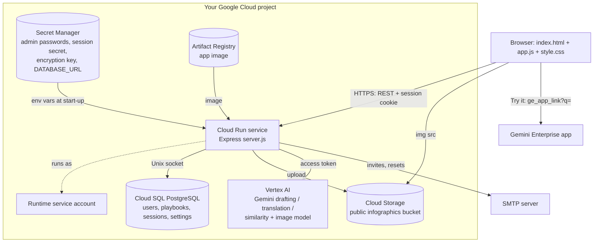
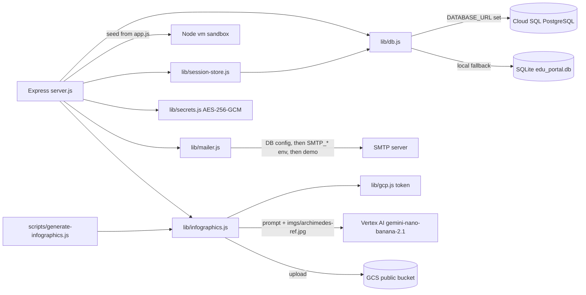
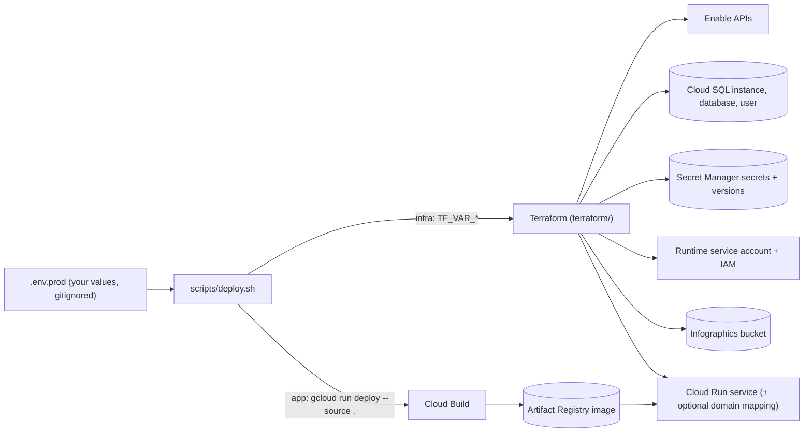
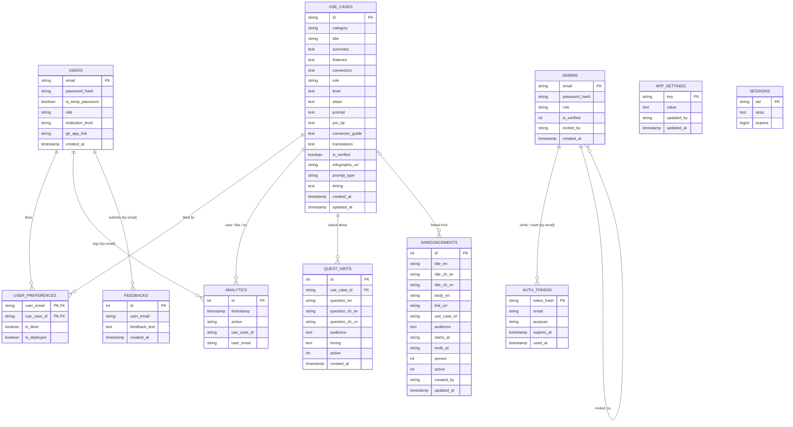

# Gemini Enterprise - Edu Portal

[](#-deployment)
[](#-architecture)
[](#-localization)

The **Gemini Enterprise - Edu Portal** is a playbook library for academic institutions adopting Gemini Enterprise. Leaders, lecturers, support staff and students browse role-specific use cases, fill in a prompt's variables once, then copy the prompt or launch it straight into their Gemini Enterprise app. Admins get user provisioning, analytics, playbook editing, infographic generation and email settings.

---

## 📖 Contents
1. [Features](#-features)
2. [Architecture](#-architecture)
3. [Database schema](#-database-schema)
4. [API overview](#-api-overview)
5. [Local development](#-local-development)
6. [Environment variables](#-environment-variables)
7. [Accounts, roles & password recovery](#-accounts-roles--password-recovery)
8. [Infographics](#-infographics)
9. [Deployment](#-deployment)
10. [Estimated monthly cost](#-estimated-monthly-cost)

Self-hosting guide, GitHub details and the full cost breakdown: [docs/HANDBOOK.md](docs/HANDBOOK.md).

---

## 🌟 Features

### Playbook library
* **Categories decide what each user sees.** There are 8: Teaching (Lecturer, TA), Research (Researcher), Programme & Faculty Leadership (Program Leader, Dean), Student Affairs (SAO), Finance, Campus Security, IT Administration and Students (defined in `lib/categories.js`). Admins tick categories on each account and on each playbook. A user sees a playbook when they share at least one category; with no categories they see an "ask your admin" empty state. There is no profile wizard or "Switch profile".
* Card grid of playbooks with dropdown filters for **Category** (the user's own categories; hidden if they have only one), **GE feature** (Agent Designer, Skills, Gemini Notebook, Deep Research, Canvas Mode, Image Generation, Video Generation), **Collection** (All / Liked) and **Sort** (popular, newest, A–Z). The headline reads "{n} playbooks for you" or "{n} playbooks · {category}".
* Each card and modal shows the **idea provider** ("Idea by …"), or "Default playbook" when there is none.
* Every card shows a **like** button (heart), a read-only **view** counter (eye), colour-toned GE feature icons and red connector icons.
* **Feature colour tones** (`tone-*` classes in `style.css`) are the same on cards, modal chips, playbook-type chips and the GE feature filter (the filter takes the selected feature's tone): Gemini Notebook / Deep Research green, Canvas Mode / Video Generation blue, Agent Designer yellow, Image Generation purple. Each tone has a light-theme variant for contrast.

### Quest Run strip
A pixel-art banner above the library (canvas renderer in `app.js`; sprites from `game/manifest.json`, with a drawn fallback for each missing asset).
* **Hero by category:** the hero follows the user's categories. Teaching or Research gives a Wizard. Otherwise any admin staff category (Programme & Faculty Leadership, Student Affairs, Finance, Campus Security, IT Administration) gives a Priest. Everyone else (Students only, or no categories) gets the default Warrior. Teaching / Research win over admin staff. The rule is `heroClassForCategories` in `lib/quest-core.js`; admins previewing with `?role=` get the hero of that role's category.
* **Academic timeline:** Semester A, Winter, Semester B and Summer with month ticks and a "today" flag. The label reads, for example, "Semester A · Week 7 · Midterms". The phases are `sem_start`, `teaching`, `midterm`, `finals`, `winter` and `summer`. Defaults are in `DEFAULT_ACADEMIC_CALENDAR`; super admins can override them in **Settings → Calendar**.
* **Quest bubble:** the hero asks a question that fits the current term and phase, for example "Drowning in essays to mark?". **Open playbook** opens the matching modal.
  * Questions come from `quest_hints`, filtered by audience and timing and picked with a weighted shuffle (`pickWeightedHint`).
  * The bubble rotates every 30 s while it's visible. A pause button stops it, and so does hovering or focusing the bubble.
* **News from Archie:** live announcements arrive as a gold scroll carried by Archie. Pinned news shows first. Users can dismiss an item; dismissals are stored in `localStorage`.
  * The **bell** shows a count of unseen news. It opens a drawer that lists all live news; Escape closes it.
* **Performance and accessibility:**
  * Capped at 30 fps. The loop pauses when the strip is off-screen or the tab is hidden.
  * `prefers-reduced-motion` draws one static frame.
  * The strip can be collapsed, and the collapsed state persists.
  * The dark theme adds a dusk tint. The scene is 180px tall (132px under 640px).
  * Views and clicks are logged to `analytics` as `quest_view`, `quest_click`, `news_view` and `news_click`.

### Enlarged use-case card (modal)
* **Header:** GE feature chips (colour-toned) and connector chips (Drive / Email / LMS / Calendar Connector, red), the title, and on the right the like button, view counter and close button at the same 44px height. Under 720px the chips and controls share the first row and the title gets the full width.
* **Hero:** the left column holds the generated infographic with the summary directly below it. The right column holds only the **Fill in the variables** panel, one input per row. Values are interpolated live into the main prompt and every helper prompt. Clicking a variable chip in a prompt focuses its field. Playbooks without variables get a single full-width column. Under 900px the hero stacks: image, summary, variables.
* **How it works:** three steps.
  1. **Set up**: optional helper prompts, each collapsed.
  2. **Sample prompt**: collapsed by default, with its prompt-type chip and actions.
  3. Connector guide, manual-upload tip and pro tip.
* **Actions:** **Try it** (green) opens `<ge_app_link>?q=<prompt>` in a new tab. **Copy prompt** (blue) copies the interpolated prompt. Both look the same in light and dark mode. If a variable is still empty, the first **Try it** click focuses that field and a second click continues anyway.
* Each modal open records a `view` event. The counter goes up optimistically and is then reconciled with the server total.

### Prompt types

| `prompt_type` | Actions |
| :--- | :--- |
| `general`, `canvas`, `image`, `video` | **Try it** + **Copy prompt** |
| `notebooklm`, `deep_research`, `agent_designer`, `skills` | **Copy prompt** only (these features can't be prefilled from a URL; a Skills prompt is the skill definition pasted into Skills) |

### Admin console
* **Users:** bulk-provision users with temporary passwords and a **Categories** checklist. **Edit user** changes a user's email (cascades to preferences, analytics and feedback) and their Gemini Enterprise app link, edits their categories, and can reset access.
* **Admins** (super admin only): lists every admin, starting with the two **default accounts** (`edu_portal_s_admin`, `edu_portal_admin`). Invite by email (`super` or `assist`), resend or remove invites. The default accounts can't be removed, but they can be **disabled / enabled** as long as at least one super admin stays active (and never the account you're signed in with).
* **Analytics:** total views, likes and tries; a 6-month line chart; an **Idea providers** dashboard (Overall / last month / 3 months / 6 months) with the top providers by playbooks, by views and by likes, plus the top community playbooks (default playbooks excluded); a most-liked playbook list.
* **Use cases:** create, edit, delete, import and export (JSON). Includes Gemini-assisted drafting with a diff viewer, plus infographic **Generate / Regenerate / Generate missing**.
  * The form also sets **Quest timing**: any of the 6 term/phase chips, or "Anytime".
  * It also holds up to 3 **Quest questions** per playbook (en / zh-TW / zh-CN).
  * **Set up prompts:** up to 5 ready-to-copy helper prompts per playbook (type, title and prompt in en / zh-TW / zh-CN), shown in step 1 of the use-case modal. Stored in `use_cases.helper_prompts` and validated by `lib/helper-prompts.js`. Blank Chinese fields fall back to the English text; removing every row stores `{}` (no helpers).
  * Gemini drafting suggests all three (Set up prompts: echoes the stored ones or drafts 1–3; document-creating ones use type `canvas`).
  * Seeded playbooks (and their Set up prompts) are re-synced from `app.js` and `lib/seed-playbooks.js` (research, Skills, and the Agent Designer chat / workflow agents; zh-TW / zh-CN in `lib/seed-playbooks.zh-*.json`) on every boot, so admin edits to seeded ids reset on the next deploy. Admin-created playbooks keep their edits.
* **News** (all admins): create, edit and delete announcements.
  * Each announcement has a trilingual title and body, an optional link or linked playbook, an audience (roles), a start/end date, and a pin option.
  * The form shows character counters, a live scroll preview and per-field validation.
  * **Translate with Gemini** fills in the zh fields. It needs Vertex AI credentials and returns 502 without them.
  * The table shows each item's status (Scheduled / Live / Ended / Off), its reach (distinct viewers) and its clicks.
* **Feedback:** review and dismiss submissions from the floating Feedback button (the modal invites use case ideas too). The button only appears in the user portal.
  * **Quality gate** (`lib/idea-quality.js`, shared by browser and server): feedback that is too short (fewer than ~4 words; Chinese counts ≈ 2 characters per word) or only generic ("great, thanks!", "test", 「很好用，謝謝」) is rejected with a localised hint asking who it's for, the task and the expected output. Real bug reports such as "Search is slow on mobile" pass.
  * **Convert to playbook** (super admin): a two-stage similarity check (below) recommends improving the best match (score ≥ 60) or creating a new one. The same Gemini call judges whether the idea is specific enough to draft from. If it isn't, the dialog shows 1–3 clarification questions (written by Gemini in the feedback's language, or template questions when Gemini is unavailable) and an **Ask the author by email** link. **Create new playbook** unlocks once at least one question is answered, and the answers are appended to the Gemini instruction. Either path opens the case form; a new playbook credits the feedback author as idea provider. Saving marks the feedback **Converted**.
  * **Similarity check on manual create:** before **Draft with Gemini** and before the first save of a new playbook, the same check runs on the title, summary and instruction. If a close match exists, the admin can improve it instead (opens it with a Gemini instruction) or **Create new anyway**.
  * **How the similarity check scales:** only compact fields are read (id, title, summary, zh title / summary), never steps or prompts. Stage 1 is a local keyword / CJK-bigram cosine shortlist (`lib/similarity.js`, the whole catalogue while it has ≤ 40 playbooks); stage 2 is a Gemini rerank of that shortlist at ~60 input tokens per playbook. Results are cached for 15 minutes and invalidated by any playbook change. Keyword ranking is the fallback when Vertex AI is unavailable.
* The case form has **Categories** (at least one) and an editable **Idea provider** (empty = default playbook).
* **One drafting path:** New playbook, Convert feedback → Create new / Improve selected, and the manual-create similarity check → Improve selected all call `POST /api/admin/generate-gemini` with `origin` (`manual` | `feedback` | `similar`), the `idea` text and the clarification answers. The server builds every brief with `buildDraftPrompt()`: the same design steps and **feature guide** (Gemini, Canvas Mode, Gemini Notebook, Deep Research, Skills, Agent Designer chat agent vs workflow agent, Image / Video Generation), so Gemini picks the features that fit the idea and explains the choice in `designNotes` (shown under the instruction box). The idea is shown read-only in the form.
* **Settings → Playbook drafting prompt** (super admin only): the editable part of that brief (role, design steps, feature guide, conventions), stored in `app_settings['draft_prompt']` and read on every draft, so a saved change applies to the next draft. The form values, the task and the JSON output contract are always appended by the server. **Reset to default** restores `DEFAULT_DRAFT_GUIDE`.
* **First-login tips:** a 5-tip overlay tour for the user portal and another for the admin console, shown once per account (`app_settings['tour_seen:<email>']`, `POST /api/tour/seen`) and replayable from the avatar menu (**Show tips**).
* **Settings → Email** (super admin only): SMTP presets (Gmail, Outlook.com, Microsoft 365, Custom) with a test send.
* **Settings → Calendar** (super admin only): edit the start and end dates of the four terms.
  * Changing a start date moves the previous term's end date to the day before, and changing an end date moves the next term's start date to the day after.
  * A live "Today: …" preview shows where today falls. **Reset** goes back to the default calendar.

### Localization
All UI strings live in `uiTranslationsV3` (with V4/V6 layers merged on top) in `app.js` (en / zh-TW / zh-CN) and are applied through `data-i18n`, `data-i18n-placeholder`, `data-i18n-aria` and `data-i18n-title`. Product names (Gemini Notebook, Gemini, Canvas Mode, Deep Research, Agent Designer, Skills, Image Generation, Video Generation) stay in English in every language.

---

## 🏗 Architecture

| Layer | Implementation |
| :--- | :--- |
| Client | `index.html` + `app.js` (vanilla ES6+, functional helpers) + `style.css` (vanilla CSS variables, light/dark; no Tailwind) |
| Server | Node.js 20 + Express (`server.js`): REST API, `express-session` cookies, `bcryptjs` hashing, VM-sandbox seeding of the 14 playbooks from `app.js` |
| Sessions | `lib/session-store.js`: `express-session` store backed by the `sessions` table, with lazy pruning. Sessions survive Cloud Run scale-to-zero and are shared across instances. |
| Database | `lib/db.js`: PostgreSQL (`pg` pool, Cloud SQL) when `DATABASE_URL` is set, otherwise SQLite (`edu_portal.db`). The schema is created and migrated on boot. |
| Secrets | Credentials (admin passwords, session secret, encryption key, `DATABASE_URL`) live in **Secret Manager** and reach Cloud Run as env vars. `lib/secrets.js` adds AES-256-GCM encryption for secret settings stored in the DB (for example the SMTP password). |
| Email | `lib/mailer.js` (nodemailer). Config comes from the DB (`app_settings.smtp`), then `SMTP_*` env vars, then demo mode. |
| GCP auth | `lib/gcp.js`: access token from the metadata server (Cloud Run) or local `gcloud`, plus the quota-project header |
| Infographics | `lib/infographics.js` + `scripts/generate-infographics.js`: Vertex AI `gemini-nano-banana-2.1` (location `global`, 16:9) with the Archimedes mascot reference image `imgs/archimedes-ref.jpg`. Images go to a public GCS bucket. |
| Quest Run | `lib/quest-core.js` (UMD module shared by the server and the browser as `window.QuestCore`): the academic calendar, term/week/phase position, hero classes and weighted hint picking. Sprites live in `game/`, and `GET /game/manifest.json` lists the assets that exist. |
| Hosting | Cloud Run (built from the `Dockerfile` by Cloud Build, image in Artifact Registry) + Cloud SQL for PostgreSQL + Secret Manager + Cloud Storage. Everything is provisioned by Terraform (`terraform/`) through `scripts/deploy.sh`. |

**Runtime** (everything inside the box lives in your project and is created by Terraform, except the Artifact Registry repository, which `gcloud run deploy --source` creates on the first app deploy; Vertex AI is an enabled API, not a resource):



**Inside the server:**



**Provisioning** (`scripts/deploy.sh`):



---

## 📊 Database schema

These tables are created by `initializeSchemas()` in `server.js` (and `sessions` by `lib/session-store.js`). Columns added later (`is_verified`, `updated_at`, `ge_app_link`, `infographic_url`, `prompt_type`, `timing`, `helper_prompts`) are added on boot with idempotent `ALTER TABLE` migrations. Types are shown for PostgreSQL; SQLite uses `TEXT` / `INTEGER` / `DATETIME` equivalents.

| Table | Columns |
| :--- | :--- |
| `users` | `email` PK, `password_hash` NOT NULL, `is_temp_password` BOOLEAN default TRUE (forces a reset on first login), `role`, `institution_level` (both legacy), `created_at`, `ge_app_link` VARCHAR(1024) (Gemini Enterprise app URL for Try it), `categories` TEXT (JSON array of category ids) |
| `use_cases` | `id` PK, `categories` TEXT (JSON array of category ids; drives visibility), `creator` (idea provider email / name; NULL = default playbook), `source_feedback_id` (feedback it was converted from), `category` (legacy), `title`, `summary`, `features` (JSON), `connectors` (JSON), `role`, `level` (JSON), `steps` (JSON), `prompt`, `pro_tip`, `connector_guide`, `translations` (JSON), `is_verified` BOOLEAN (deprecated, unused), `created_at`, `updated_at`, `infographic_url` VARCHAR(1024), `prompt_type` VARCHAR(50) default `'general'`, `timing` (JSON array of phases `sem_start`, `teaching`, `midterm`, `finals`, `winter`, `summer`, or `["anytime"]`; NULL = anytime), `helper_prompts` TEXT (JSON `{ "en": [{type,title,prompt}], "zh-TW": [...], "zh-CN": [...] }`; NULL = use the static list in `app.js`, `{}` = none) |
| `user_preferences` | (`user_email` FK→users, `use_case_id` FK→use_cases) composite PK, `is_liked` BOOLEAN, `is_deployed` BOOLEAN (legacy, unused). Both FKs `ON DELETE CASCADE`. |
| `analytics` | `id` SERIAL PK, `timestamp`, `action` (`view` \| `like` \| `try` \| `quest_view` \| `quest_click` \| `news_view` \| `news_click`; old rows may hold `deploy`), `use_case_id` (for quest/news events: `hint:<id>` / `news:<id>`), `user_email` |
| `feedbacks` | `id` SERIAL PK, `user_email` NOT NULL, `feedback_text` NOT NULL, `created_at`, `converted_use_case_id`, `converted_at` |
| `admins` | `email` PK, `password_hash` (NULL until verified), `role` CHECK IN (`super`, `assist`), `is_verified` INTEGER, `invited_by`, `created_at` |
| `auth_tokens` | `token_hash` PK (SHA-256 of the emailed token), `email`, `purpose` (`verify` \| `reset`), `expires_at` (48 h verify / 1 h reset), `used_at` (single use) |
| `quest_hints` | `id` SERIAL PK, `use_case_id` NOT NULL, `question_en` NOT NULL, `question_zh_tw`, `question_zh_cn`, `audience` (JSON roles; `[]` = everyone), `timing` (JSON; overrides the playbook's timing), `active`, `created_at`. 22 starter questions are seeded on first boot. |
| `announcements` | `id` SERIAL PK, `title_en` NOT NULL (≤ 120), `title_zh_tw`, `title_zh_cn`, `body_en` / `body_zh_tw` / `body_zh_cn` (≤ 300), `link_url`, `use_case_id`, `audience` (JSON roles), `starts_at` / `ends_at` (`YYYY-MM-DD`, inclusive, compared with the viewer's local date), `pinned`, `active`, `created_by`, `created_at`, `updated_at` |
| `app_settings` | `key` PK (for example `smtp`, `academic_calendar`), `value` (JSON; secret fields encrypted), `updated_by`, `updated_at` |
| `sessions` | `sid` PK, `sess` (JSON), `expires` BIGINT (epoch ms) |

The obsolete `verification_checkpoints` table is dropped on boot.

> **Deprecated:** `use_cases.is_verified` is no longer used. The use-case "Verified" badge, filter, admin column and checkbox were removed, and the API neither reads, writes nor returns it. The column stays in the schema for backward compatibility with existing databases. (`admins.is_verified` is unrelated and still drives the admin invite / email verification flow.)



---

## 🔌 API overview

All endpoints return JSON and use the session cookie. "User" means a signed-in standard user (401 `session_expired` / 403 `admin_preview` otherwise). "Super" means a super admin.

| Method & path | Access | Purpose |
| :--- | :--- | :--- |
| `POST /api/auth/login` | Public | Sign in (user email or admin username) |
| `POST /api/auth/reset-password` | User | Replace a temporary password |
| `GET /api/auth/session` | Public | Current session, role and categories |
| `POST /api/auth/forgot-password` | Public | Email a reset link (verified DB admins) |
| `POST /api/auth/complete-token` | Public | Finish `?verify=` / `?reset=` and set a password |
| `POST /api/auth/logout` | Any | End the session |
| `GET /api/use-cases` | Signed in | Playbooks visible to the user's categories (admins: all) with `categories`, `creator`, `likeCount`, `viewCount`, the user's like state, `infographicUrl`, `promptType` |
| `POST /api/use-cases/like` | User | Toggle a like |
| `POST /api/use-cases/view` | Signed in | Record a view; returns the new `viewCount` |
| `POST /api/use-cases/try` | Signed in | Log a Try it launch |
| `POST /api/feedbacks` | User | Submit feedback (400 `code: too_short / too_vague / too_long` from the quality gate) |
| `GET /api/feedbacks` · `POST /api/feedbacks/delete` | Admin · Super | List (with conversion status) · dismiss feedback |
| `POST /api/admin/feedbacks/:id/similar` · `POST /api/admin/feedbacks/:id/convert` | Super | Similar playbooks + enhance / new recommendation + `clarity` (actionable, missing, questions) · link feedback to a playbook |
| `POST /api/admin/use-cases/similar` | Super | `{title, summary, instruction, excludeId?}` → similar playbooks before creating one by hand |
| `GET/POST/PUT/DELETE /api/admin/users` · `POST/PUT /api/admin/users/reset` | Admin (writes: Super) | List, provision, edit, delete, reset users |
| `GET/POST/DELETE /api/admin/admins` · `POST /api/admin/admins/resend` | Super | List all admins (default accounts first) · invite · remove · resend invites |
| `PUT /api/admin/admins/builtin` | Super | Enable / disable a default admin (`{ username, disabled }`); rejected if it would leave no active super admin or targets yourself |
| `GET /api/admin/stats` | Admin | Totals and 6-month history (views / likes / tries) |
| `GET /api/admin/stats/creators?range=all\|1m\|3m\|6m` | Admin | Idea provider summary and leaderboards (playbooks, views, likes) |
| `POST/PUT/DELETE /api/admin/use-cases` · `GET /api/admin/use-cases/export` | Super · Admin | Edit · export playbooks |
| `POST /api/admin/use-cases/:id/infographic` · `POST /api/admin/infographics/generate-missing` | Super | Generate infographics |
| `GET/PUT /api/admin/settings/smtp` · `POST /api/admin/settings/smtp/test` | Super | SMTP settings and test send |
| `POST /api/admin/generate-gemini` | Super | Gemini-assisted playbook drafting with `GEMINI_MODEL`; body adds `origin`, `idea`, `clarifications` (also suggests `promptType`, `timing`, quest questions and Set up prompts `helperPrompts`). Replies are normalised by `lib/draft-normalize.js`: `{{VARIABLE}}` tokens, portal category / feature / connector names. |
| `GET /game/manifest.json` | Public | Quest Run sprite manifest (only assets that exist on disk) |
| `GET /api/quest` | Signed in | Academic position, hero class, eligible quest hints and live news for the viewer's role |
| `POST /api/quest/event` | Signed in | Log `quest_view` / `quest_click` / `news_view` / `news_click` |
| `GET/POST/PUT/DELETE /api/admin/hints` | Admin (writes: Super) | Manage quest questions |
| `GET/POST/PUT/DELETE /api/admin/announcements` | Admin | Manage news; GET adds `seenCount` and `clickCount`; 400 responses carry per-field `errors` |
| `GET/PUT/DELETE /api/admin/settings/draft-prompt` | Super | Read, save or reset the playbook drafting prompt (200–30,000 characters) |
| `POST /api/tour/seen` | Signed in | `{ portal: 'user' \| 'admin' }` marks the first-login tips as seen for this account (`/api/auth/session` returns `tourSeen`) |
| `GET/PUT/DELETE /api/admin/settings/calendar` | Super | Read, save or reset the academic calendar (validated: ordered, contiguous terms) |
| `POST /api/admin/translate` | Admin | Gemini translation of news fields into zh-TW / zh-CN |

---

## 🚀 Local development

Prerequisites: Node.js 18+ (the container uses 20) and npm. The Google Cloud features (Draft with Gemini, infographics) also need the `gcloud` CLI.

```bash
git clone <REPO_URL>
cd edu-ge-adoption-portal
npm ci
cp .env.example .env    # fill in what you need; everything is optional locally
npm start               # SQLite is used automatically when DATABASE_URL is blank
# open http://localhost:8080 (override with PORT)
```

* **First sign-in:** set `SUPER_ADMIN_PASSWORD` in `.env` and sign in as `edu_portal_s_admin`. If you leave it blank, the server prints a one-off random password for that account at startup (local runs only; in production the account stays disabled until the variable is set).
* **Demo user (optional):** set `DEMO_USER_EMAIL` and `DEMO_USER_PASSWORD` to have a standard user created on first boot. No user exists by default.
* **Postgres locally:** set `DATABASE_URL` (and `DISABLE_PG_SSL=true` for a local server without TLS).
* **Google Cloud calls** use your `gcloud auth application-default` / `gcloud auth print-access-token` credentials against `GCP_PROJECT_ID` (or your `gcloud` default project), billed to `GCP_QUOTA_PROJECT`.

---

## ⚙️ Environment variables

[`.env.example`](.env.example) is the full, commented list and the only template. Copy it to `.env` (or one file per environment such as `.env.dev` / `.env.prod`). Every `.env*` file except the template is gitignored.

**Deployment target** (read by [`scripts/deploy.sh`](scripts/deploy.sh) and passed to Terraform):

| Variable | Required | Purpose |
| :--- | :---: | :--- |
| `GCP_PROJECT_ID` | ✅ | Project ID to deploy into. Also used at runtime for Vertex AI. |
| `GCP_REGION` | ✅ | Region for Cloud Run, Cloud SQL and the bucket |
| `CLOUD_RUN_SERVICE` | ✅ | Cloud Run service name; also prefixes the secrets and the runtime service account |
| `CLOUD_SQL_INSTANCE`, `CLOUD_SQL_DATABASE` | ✅ / – | Cloud SQL instance and database name (default `edu_portal`) |
| `INFOGRAPHIC_BUCKET` | ✅ | Globally unique public bucket for infographics |
| `CUSTOM_DOMAIN` | – | Custom domain; sets `PUBLIC_BASE_URL` and a Cloud Run domain mapping |
| `CLOUD_SQL_TIER`, `CLOUD_SQL_DELETION_PROTECTION`, `ALLOW_UNAUTHENTICATED`, `CLOUD_RUN_MAX_INSTANCES` | – | Sizing and safety switches |
| `TF_STATE_BUCKET` | – | GCS bucket for Terraform state (blank = local state, one workspace per environment) |

**Secrets** (Terraform stores them in Secret Manager; Cloud Run reads them from there):

| Variable | Required | Purpose |
| :--- | :---: | :--- |
| `SUPER_ADMIN_PASSWORD` | ✅ deploy | Password for the built-in super admin `edu_portal_s_admin` (min 12 chars) |
| `ADMIN_PASSWORD` | – | Built-in assistant admin `edu_portal_admin`. Blank = account disabled. |
| `SESSION_SECRET` | – | Signs session cookies. Blank on deploy = generated by Terraform. |
| `SETTINGS_ENCRYPTION_KEY` | – | AES-256-GCM key for secrets in `app_settings` (SMTP password). Blank on deploy = generated. |
| `DB_PASSWORD` | – | Cloud SQL `postgres` password. Blank = generated. |
| `DEMO_USER_EMAIL`, `DEMO_USER_PASSWORD`, `DEMO_USER_GE_APP_LINK` | – | Optional demo user created on first boot |

**App runtime:**

| Variable | Purpose |
| :--- | :--- |
| `PORT` | HTTP port (default `8080`) |
| `NODE_ENV` | `production` on Cloud Run (built-in admins without a password stay disabled) |
| `DATABASE_URL` / `SQLITE_PATH` | PostgreSQL connection string; blank = SQLite file (default `edu_portal.db`) |
| `DISABLE_PG_SSL` | `true` when connecting over the Cloud SQL Unix socket |
| `GEMINI_MODEL` | Model for admin drafting and translation (default `gemini-3.8-flash`) |
| `INFOGRAPHIC_MODEL`, `INFOGRAPHIC_LOCATION`, `INFOGRAPHIC_PROJECT`, `INFOGRAPHIC_REF_IMAGE`, `INFOGRAPHIC_CONCURRENCY` | Infographic generation settings |
| `INFOGRAPHIC_SEED_IMAGES` | `true` only if `INFOGRAPHIC_BUCKET` already holds the pre-generated seed images |
| `PUBLIC_BASE_URL` | Base URL for emailed links (otherwise the request origin) |
| `GCP_QUOTA_PROJECT`, `GCP_FORCE_QUOTA_HEADER` | Quota / billing project header for local credentials |
| `SMTP_HOST`, `SMTP_PORT`, `SMTP_SECURITY`, `SMTP_USER`, `SMTP_PASS`, `SMTP_FROM_NAME`, `SMTP_FROM_EMAIL` | SMTP fallback when nothing is saved in Admin → Settings → Email |

> [!CAUTION]
> Never put passwords, connection strings with credentials or encryption keys in this README, in Terraform files or in Git. Keep them in your local `.env*` files (gitignored) and Secret Manager.

---

## 🔐 Accounts, roles & password recovery

* **Standard users** are provisioned by an admin with an auto-generated temporary password and must change it on first sign-in. What they see is decided by the categories an admin ticks on their account.
* **Default admin accounts** (`edu_portal_s_admin` = super, `edu_portal_admin` = assist). Their passwords come only from `SUPER_ADMIN_PASSWORD` / `ADMIN_PASSWORD` (Secret Manager in the cloud); an account without a password shows as *Not configured* and can't sign in.
  * Both appear at the top of **Admin → Admins**. A super admin can **disable** either one (for example once named super admins have been invited) and enable it again later. The state is stored in `app_settings['builtin_admins']`, and a disabled account's open sessions end within about 10 seconds.
  * The portal always keeps **at least one active super admin**: disabling `edu_portal_s_admin` needs another verified super admin, and the last active super admin can't be removed. Nobody can disable the account they're signed in with.
  * Recovery if every super admin is locked out: run `DELETE FROM app_settings WHERE key = 'builtin_admins';` against the database to re-enable the default accounts.
* **Invited admins** (`admins` table): a super admin invites an email address. The invitee gets a single-use `/?verify=TOKEN` link (48 h) and sets a password. Verified admins can use **Forgot password?**, which sends a `/?reset=TOKEN` link (1 h). Tokens are stored only as SHA-256 hashes.

| Capability | Super | Assist |
| :--- | :---: | :---: |
| View analytics, export playbooks, read feedback | ✅ | ✅ |
| Add / edit / delete / import playbooks, generate infographics | ✅ | ❌ |
| Provision / edit users, reset access | ✅ | ❌ |
| Dismiss feedback | ✅ | ❌ |
| Invite / remove admins, enable / disable default admins, SMTP settings | ✅ | ❌ |

**Email:** configure SMTP in **Admin → Settings → Email**. The SMTP password is encrypted at rest. With no SMTP configured, the portal runs in demo mode: links are written to the server log and shown to the super admin only.

> [!TIP]
> Gmail and Microsoft 365 usually require an app password (or SMTP AUTH enabled for the mailbox) instead of the normal sign-in password.

---

## 🖼️ Infographics

Each playbook can have a 16:9 infographic generated with Vertex AI `gemini-nano-banana-2.1`. The prompt includes per-case concept hints, and the Archimedes mascot reference (`imgs/archimedes-ref.jpg`) is sent as inline image data so the character stays consistent. Images are uploaded via the GCS JSON API to a public bucket, and the URL (with a `?v=` cache-buster) is stored in `use_cases.infographic_url`.

```bash
npm run infographics                 # only playbooks without an infographic
npm run infographics -- --force      # regenerate everything
npm run infographics -- --id=<id>    # a single playbook
```

A new bucket starts empty, so generate the images once after the first deploy (**Admin → Use cases → Generate missing**, or the CLI above with `.env` pointing at your project). Admins can also regenerate single playbooks from **Admin → Use cases**. The Cloud Run service account needs `roles/aiplatform.user` and object-admin access to the bucket. The bucket grants `allUsers` `roles/storage.objectViewer`.

---

## ☁️ Deployment

Target: **Cloud Run** + **Cloud SQL for PostgreSQL** + **Secret Manager** + a public **Cloud Storage** bucket, all in your own project. Nothing in the repo points at a particular project, service or domain; [`scripts/deploy.sh`](scripts/deploy.sh) reads everything from an env file.

### 1. Prerequisites

* A Google Cloud project with billing enabled, and an account with Owner (or equivalent) on it
* [`gcloud`](https://cloud.google.com/sdk/docs/install) and [Terraform](https://developer.hashicorp.com/terraform/install) ≥ 1.5

```bash
gcloud auth login
gcloud auth application-default login     # credentials Terraform uses
```

### 2. Describe your environment

```bash
cp .env.example .env.prod                 # or .env, .env.dev, ...
```

Fill in at least `GCP_PROJECT_ID`, `GCP_REGION`, `CLOUD_RUN_SERVICE`, `CLOUD_SQL_INSTANCE`, `INFOGRAPHIC_BUCKET` and `SUPER_ADMIN_PASSWORD`. Leave `SESSION_SECRET`, `SETTINGS_ENCRYPTION_KEY` and `DB_PASSWORD` blank to have Terraform generate them. The script refuses to run while a required value is empty or still a placeholder.

For several environments, keep one file each with different `CLOUD_RUN_SERVICE` (and `CLOUD_SQL_DATABASE` / `INFOGRAPHIC_BUCKET`) values. They can share a project and Cloud SQL instance.

### 3. Deploy

```bash
./scripts/deploy.sh plan --env-file .env.prod   # preview the Terraform changes
./scripts/deploy.sh      --env-file .env.prod   # Terraform apply, then build + deploy the app
```

| Command | What it does |
| :--- | :--- |
| `./scripts/deploy.sh [all]` | `terraform apply`, then `gcloud run deploy --source .` |
| `./scripts/deploy.sh infra` | Terraform only (APIs, Cloud SQL, secrets, service account, bucket, Cloud Run config) |
| `./scripts/deploy.sh app` | New app revision only (keeps the env vars and secrets Terraform set) |
| `./scripts/deploy.sh plan` | `terraform plan` |
| `./scripts/deploy.sh destroy` | `terraform destroy` (needs `CLOUD_SQL_DELETION_PROTECTION=false` applied first; deletes all data) |

Add `--env-file <file>` to pick the environment (default `.env`) and `--yes` to skip Terraform's confirmation.

Terraform ([`terraform/`](terraform)) creates:

* the required APIs, a Cloud SQL Postgres 15 instance, database and user
* a dedicated runtime service account with `roles/cloudsql.client`, `roles/aiplatform.user`, object admin on the bucket and access to its own secrets only
* one Secret Manager secret per credential, named `<CLOUD_RUN_SERVICE>-<variable>` (for example `edu-portal-super-admin-password`)
* the Cloud Run service (placeholder image on the first apply; Terraform then ignores image changes so `deploy.sh app` owns releases), public ingress and the optional domain mapping
* the public infographics bucket

On first boot the app creates the schema, runs migrations and seeds the playbooks. Then sign in as `edu_portal_s_admin` and generate the infographics.

> [!IMPORTANT]
> Terraform state contains the generated secrets. Local state lives in `terraform/terraform.tfstate.d/` (gitignored); for teams set `TF_STATE_BUCKET` to a private, versioned GCS bucket. Existing resources created by hand must be brought in with `terraform import` before the first `apply`.

> [!NOTE]
> Cloud Run domain mappings need a verified domain and are only offered in some regions. Elsewhere, put an external HTTPS load balancer in front and still set `CUSTOM_DOMAIN` so emailed links use it.

### Rotating a secret

```bash
printf '%s' 'NEW_VALUE' | gcloud secrets versions add <CLOUD_RUN_SERVICE>-super-admin-password --data-file=- --project <PROJECT_ID>
./scripts/deploy.sh app --env-file .env.prod   # new revision picks up "latest"
```

Update the value in your env file too, so the next `terraform apply` doesn't roll it back.

---

## 💰 Estimated monthly cost

List prices checked 2026-10-21 (USD per month, on-demand, asia-east2 / Hong Kong). Full assumptions and unit prices: [docs/HANDBOOK.md](docs/HANDBOOK.md#3-monthly-cost-estimate-google-cloud).

| Scenario | Cloud SQL tier | asia-east2 | us-central1 |
| :--- | :--- | ---: | ---: |
| Pilot (~50 users, ~20k requests) | `db-f1-micro` (default) | ≈ $16 | ≈ $11 |
| Department (~500 users, ~200k requests) | `db-g1-small` | ≈ $49 | ≈ $35 |
| Campus-wide (~5,000 users, ~2M requests) | `db-custom-1-3840` | ≈ $129 | ≈ $97 |

Cloud SQL is most of the bill; Cloud Run scales to zero and usually stays inside its free tier. Gemini (drafting, translation, infographics) is pay-per-use and only triggered by admins.

---

*Gemini Enterprise - Edu Portal: playbooks that go from idea to prompt in one click.*
