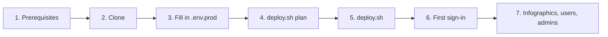
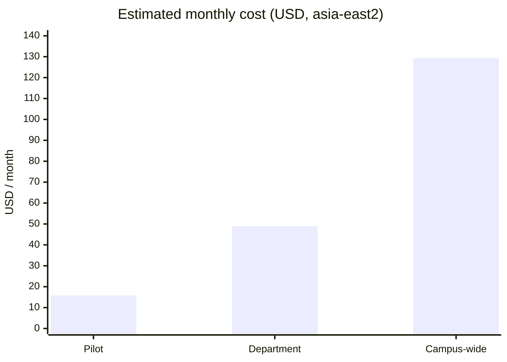

# Edu Portal handbook

This document complements the [README](../README.md). It covers where the code lives, how to stand up your own copy on Google Cloud, and what that costs per month.

---

## 1. GitHub repository

| Item | Value |
| :--- | :--- |
| Repository | https://github.com/MrRoyRoy/ge_learning_portal_edu (public) |
| Clone (HTTPS) | `git clone https://github.com/MrRoyRoy/ge_learning_portal_edu.git` |
| Clone (SSH) | `git clone git@github.com:MrRoyRoy/ge_learning_portal_edu.git` |
| Default branch | `main` (production-ready) |
| Other branches | `dev/quest-run` (historic feature branch, merged into `main`) |
| Tags | `v1.0.0` (first release), `local_w/o_db` (SQLite-only snapshot) |
| Licence | None yet. Without a `LICENSE` file, others may view and fork the code on GitHub but have no explicit right to reuse it. Add one (for example Apache-2.0) if you want to allow reuse. |

### What's in the repo

| Path | Contents |
| :--- | :--- |
| `server.js` | Express server: REST API, auth, admin console endpoints, schema creation and migrations, playbook seeding |
| `app.js`, `index.html`, `style.css` | Single-page client (vanilla JS / CSS), the seeded playbooks and all UI strings (en / zh-TW / zh-CN) |
| `lib/` | Shared modules: database, sessions, mailer, encryption, GCP auth, infographics, categories, Quest Run core, similarity, draft normalisation |
| `scripts/deploy.sh` | One-command provisioning and deploys from an env file |
| `scripts/generate-*.js` | Infographic, game-asset and favicon generators |
| `terraform/` | Infrastructure as code (APIs, Cloud SQL, Secret Manager, service account, bucket, Cloud Run, optional domain) |
| `.env.example` | The only configuration template; copy it per environment |
| `Dockerfile` | Container image used by Cloud Run |
| `game/`, `imgs/`, `fonts/` | Quest Run sprites, the mascot reference image, web fonts |
| `AGENT.md` | Engineering notes for contributors and coding agents |

### Repository hygiene

* **No credentials or environment details in git.** Passwords, keys, project IDs, service names and domains live only in your own `.env*` files (gitignored) and in Secret Manager. The history was rewritten to remove earlier traces, so if you cloned before that, re-clone.
* **Never commit:** `.env*` (except `.env.example`), `AGENT.local.md`, `*.db`, `node_modules/`, `scratch/` or Terraform state. `.gitignore` and `.gcloudignore` already exclude them.

---

## 2. Provision your own instance

Allow about 20–30 minutes; most of it is Cloud SQL creation.



### Step 1: Prerequisites

* A Google Cloud project with **billing enabled**, and an account with **Owner** (or Editor + Project IAM Admin + Secret Manager Admin) on it.
* Installed locally: [Google Cloud CLI](https://cloud.google.com/sdk/docs/install), [Terraform](https://developer.hashicorp.com/terraform/install) ≥ 1.5, Git, and Node.js 18+ (only for local runs).
* Sign in:

```bash
gcloud auth login
gcloud auth application-default login      # the credentials Terraform uses
gcloud config set project <YOUR_PROJECT_ID>
```

### Step 2: Clone

```bash
git clone https://github.com/MrRoyRoy/ge_learning_portal_edu.git edu-portal
cd edu-portal
```

### Step 3: Describe your environment

```bash
cp .env.example .env.prod
chmod 600 .env.prod
```

Open `.env.prod` and fill in **before running Terraform**:

| Variable | Example | Notes |
| :--- | :--- | :--- |
| `GCP_PROJECT_ID` | `my-school-portal` | Project ID (not the number) |
| `GCP_REGION` | `asia-east2` | Region for Cloud Run, Cloud SQL and the bucket |
| `CLOUD_RUN_SERVICE` | `edu-portal` | Also prefixes secret names and the runtime service account |
| `CLOUD_SQL_INSTANCE` | `edu-portal-sql` | New Cloud SQL instance name |
| `CLOUD_SQL_DATABASE` | `edu_portal` | Database inside the instance |
| `CLOUD_SQL_TIER` | `db-f1-micro` | Size; see the cost section |
| `INFOGRAPHIC_BUCKET` | `my-school-portal-edu-infographics` | Globally unique bucket name |
| `SUPER_ADMIN_PASSWORD` | *(your choice, ≥ 12 chars)* | Password of the default super admin `edu_portal_s_admin` |
| `ADMIN_PASSWORD` | *(optional)* | Password of the default assistant admin `edu_portal_admin`; blank = not configured |
| `CUSTOM_DOMAIN` | *(optional)* `portal.example.edu` | Creates a Cloud Run domain mapping |
| `TF_STATE_BUCKET` | *(optional)* | Private, versioned GCS bucket for shared Terraform state |

Leave `SESSION_SECRET`, `SETTINGS_ENCRYPTION_KEY` and `DB_PASSWORD` blank so Terraform generates strong random values. SMTP can be configured later in the admin console. `deploy.sh` refuses to run while a required value is empty or still a placeholder.

> [!TIP]
> For a separate test environment, create `.env.dev` with a different `CLOUD_RUN_SERVICE`, `CLOUD_SQL_DATABASE` and `INFOGRAPHIC_BUCKET`. It can share the project and the Cloud SQL instance.

### Step 4: Preview

```bash
./scripts/deploy.sh plan --env-file .env.prod
```

Expect roughly 35–40 resources: APIs, the Cloud SQL instance / database / user, Secret Manager secrets and versions, the runtime service account and its IAM bindings, the bucket, and the Cloud Run service.

### Step 5: Deploy

```bash
./scripts/deploy.sh --env-file .env.prod          # terraform apply, then build + deploy the app
```

1. **Terraform** enables the APIs and creates Cloud SQL, Secret Manager secrets, the runtime service account (least privilege), the public infographics bucket and the Cloud Run service.
2. **Cloud Build** builds the container from the `Dockerfile`, stores it in Artifact Registry and rolls out a new Cloud Run revision.
3. The script prints the service URL. On first boot the app creates the schema and seeds the playbooks.

Later releases only need `./scripts/deploy.sh app --env-file .env.prod`.

### Step 6: First sign-in and hardening

1. Open the service URL and sign in as `edu_portal_s_admin` with your `SUPER_ADMIN_PASSWORD`.
2. **Admin → Users → Admins:** invite named super / assistant admins by email (configure **Settings → Email** first so invites are delivered).
3. When at least one named super admin is active, consider **disabling** the default accounts in the same table. The portal always keeps at least one active super admin.
4. **Settings → Email:** add SMTP (Gmail / Microsoft 365 usually need an app password).
5. **Settings → Calendar:** set your institution's term dates.

### Step 7: Content and users

* **Admin → Use cases → Generate missing** creates the infographics (Vertex AI) in your bucket.
* **Admin → Users:** provision staff and students with temporary passwords and tick their **Categories**; set each user's Gemini Enterprise app link for *Try it*.
* Add playbooks, quest questions and news as needed. Convert good user feedback into playbooks.

### Day-2 operations

| Task | Command / place |
| :--- | :--- |
| Release a new version | `./scripts/deploy.sh app --env-file .env.prod` |
| Change infrastructure settings | edit `.env.prod`, then `./scripts/deploy.sh infra --env-file .env.prod` |
| Rotate a password / secret | `printf '%s' 'NEW' \| gcloud secrets versions add <service>-super-admin-password --data-file=-`, update `.env.prod`, then `deploy.sh app` |
| Read a password | `gcloud secrets versions access latest --secret <service>-super-admin-password` |
| Logs | Cloud Console → Cloud Run → service → Logs, or `gcloud run services logs read <service> --region <region>` |
| Backups | Automated daily Cloud SQL backups (7 kept by default); restore from Cloud Console → SQL → Backups |
| Tear down | set `CLOUD_SQL_DELETION_PROTECTION=false`, run `deploy.sh infra`, then `./scripts/deploy.sh destroy --env-file .env.prod`. This deletes the database and all portal data. |

> [!IMPORTANT]
> Terraform state contains the generated secrets. Keep local state on your machine only, or use a private, versioned `TF_STATE_BUCKET`.

---

## 3. Monthly cost estimate (Google Cloud)

List prices from the official Google Cloud pricing pages, checked on **2026-10-21**, in **USD per month**, on-demand (no committed-use discounts, before tax). The default region in the examples is **asia-east2 (Hong Kong)**, with us-central1 for comparison. Usage volumes are assumptions, so treat the totals as planning figures and confirm them with the [Google Cloud Pricing Calculator](https://cloud.google.com/products/calculator).

### Scenarios

| | (a) Pilot | (b) Department | (c) Campus-wide |
| :--- | :---: | :---: | :---: |
| Users | ~50 | ~500 | ~5,000 |
| Requests / month | ~20k | ~200k | ~2M |
| Internet egress | ~2 GiB | ~15 GiB | ~100 GiB |
| Gemini drafts / infographics | 10 / 20 | 100 / 50 | 500 / 100 |
| Cloud SQL tier (`CLOUD_SQL_TIER`) | `db-f1-micro` (default) | `db-g1-small` | `db-custom-1-3840` |

### Estimate (asia-east2)

| Component | (a) Pilot | (b) Department | (c) Campus-wide |
| :--- | ---: | ---: | ---: |
| Cloud Run (1 vCPU / 512 MiB, scale to zero; free tier applied) | $0.00 | $0.00 | $16.68 |
| Cloud SQL instance | $11.53 | $38.33 | $74.00 |
| Cloud SQL SSD (10 GiB) + backups | $2.67 | $2.79 | $3.15 |
| Secret Manager (~7 secrets) | $0.24 | $0.24 | $0.25 |
| Cloud Storage (infographics) | $0.01 | $0.03 | $0.21 |
| Artifact Registry (container images) | $0.05 | $0.05 | $0.05 |
| Cloud Build (within 2,500 free min) | $0.00 | $0.00 | $0.00 |
| Internet egress ($0.12/GiB) | $0.24 | $1.80 | $12.00 |
| Vertex AI Gemini 3.8 Flash (drafting, translation, similarity) | $0.39 | $3.90 | $19.50 |
| Vertex AI image model (infographics, ~$0.035 each) | $0.70 | $1.75 | $3.50 |
| **Total, asia-east2** | **≈ $16** | **≈ $49** | **≈ $129** |
| Total, us-central1 (same usage) | ≈ $11 | ≈ $35 | ≈ $97 |



### How to read it

* **Cloud SQL is the main cost** (about 60–90 %). It runs 24/7, while Cloud Run scales to zero and stays inside its free tier (180k vCPU-s, 360k GiB-s and 2M requests per billing account) until roughly 1M requests a month.
* **Cheapest useful setup:** the default `db-f1-micro` is fine for a pilot and even a small department (≈ $22 / month for scenario b). Shared-core tiers have no SLA. Move to `db-g1-small` or a dedicated-core tier when pages slow down or for production commitments.
* **Region:** Hong Kong is about 1.3–1.45× us-central1. Cloud Run is Tier 2 there, Cloud SQL is about 1.5×, and there's no free egress or Cloud Storage free tier in asia-east2. Choose the region closest to your users, or the one your data-residency policy requires.
* **Extra environments:** a dev / test copy sharing the same Cloud SQL instance (its own database, service and bucket) adds only cents to a few dollars, because Cloud Run scales to zero. A separate instance adds the full instance price again.
* **Gemini usage** is pay-per-use and only triggered by admins (drafting, translation, feedback similarity, infographics). Gemini 3.8 Flash has an introductory price ($0.75 / $3.75 per 1M input / output tokens) until 2026-12-31; the table uses the standard price from 2027 ($1.50 / $7.50). These models are served from the Vertex AI **global** endpoint, not from asia-east2, so check that this fits your data-residency policy.
* **Cloud Run** figures assume no request concurrency and include cold starts, so they're an upper bound; real campus-wide cost is likely 30–60 % lower.

### Assumptions and exclusions

* Cloud Run: 300 ms average per request, ~5 s start-up with CPU boost per cold start (300 / 1,000 / 2,000 cold starts a month).
* Cloud SQL: zonal (not HA), 10 GiB SSD, automated backups of about 1 / 2 / 5 GiB.
* Gemini: ~6k input + 4k output tokens per draft; infographics at 1K resolution.
* **Not included:** high-availability Cloud SQL (≈ 2× the instance and storage), an external HTTPS load balancer / Cloud CDN / Cloud Armor (from about $18 / month, only needed where Cloud Run domain mapping isn't available), logging above the free 50 GiB / month, your SMTP provider and your Gemini Enterprise licences.
* **Savings:** 1-year committed-use discounts (Cloud SQL about −25 %), or stopping a dev Cloud SQL instance when unused.

### Unit prices used (asia-east2 · us-central1)

| Service | asia-east2 | us-central1 |
| :--- | :--- | :--- |
| Cloud Run CPU / memory (active) | $0.0000336 per vCPU-s · $0.0000035 per GiB-s | $0.000024 · $0.0000025 |
| Cloud Run requests | $0.40 per million | $0.40 per million |
| Cloud SQL `db-f1-micro` / `db-g1-small` / `db-custom-1-3840` | $11.53 / $38.33 / $74.00 per month | $7.67 / $25.55 / $49.31 |
| Cloud SQL SSD · backups | $0.255 · $0.12 per GiB-month | $0.17 · $0.08 |
| Secret Manager | $0.06 per active version (6 free); $0.03 per 10k accesses (10k free) | same |
| Cloud Storage Standard | $0.023 per GiB-month (no free tier) | $0.020 (5 GB free) |
| Artifact Registry | $0.10 per GiB-month (0.5 GiB free) | same |
| Cloud Build | 2,500 free minutes, then $0.006 per minute | same |
| Internet egress to Asia | $0.12 per GiB | $0.12 per GiB (first GiB free) |
| Gemini 3.8 Flash (global) | $1.50 / $7.50 per 1M input / output tokens (intro $0.75 / $3.75 to 2026-12-31) | same |
| Gemini Nano Banana 2.1 image | ≈ $0.034 per 1K image | same |

Sources: [Cloud Run](https://cloud.google.com/run/pricing) · [Cloud SQL](https://cloud.google.com/sql/pricing) · [Secret Manager](https://cloud.google.com/secret-manager/pricing) · [Cloud Storage](https://cloud.google.com/storage/pricing) · [Artifact Registry](https://cloud.google.com/artifact-registry/pricing) · [Cloud Build](https://cloud.google.com/build/pricing) · [Network](https://cloud.google.com/vpc/network-pricing) · [Vertex AI](https://cloud.google.com/vertex-ai/generative-ai/pricing)
